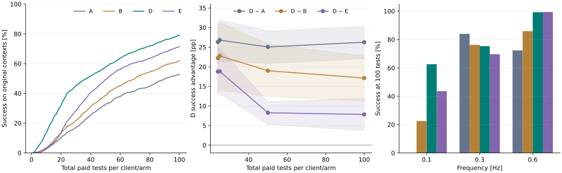

# Controller tuning beyond 24 tests: absolute quality improves and D retains a lead

27 November 2026. Results commit `493d5d91f` on
`experiment/tracking-budget-100`. This is the
[frozen matched continuation](../../tracking_budget_extension.md) of ten
already examined programmes, with every-round lossless communication and
unchanged A/B/D/E settings.

**The 24-test result was far from convergence. D improves from 40.11% to
79.13% near-reference success at 100 tests on exactly the same original
context sets. It retains a clear lead over A and B. The matched local E
improves strongly too, reducing D's early lead from 18.79 to 7.83 percentage
points without eliminating the average benefit of sharing cost information.**



## What was held fixed

Each total budget includes one factory-controller test. The original first
24 tests, model states, local histories, communication caches and final
round-24 publication were retained. A single continuation to 100 supplies
the 25/50/100 checkpoints. There are 8,640 reused and 27,360 additional paid
requests, 36,000 in total. The physical pool, dynamics, objective, six speeds,
three frequencies, eligibility rule and all method settings are unchanged.

All methods use the same paid peer-first verification rule, with catalogues
formed from their own arm's discoveries. A has the adaptive local GP; B adds
the local 65-coefficient mean. D uses shared/local exact contextual inference;
E uses the matched independent marginal prior and acquisition bonus. D/E is
the comparison that isolates the value of added cost information beyond the
common peer-verification mechanism; D/A alone also changes modeling choices.

The primary curves score each client's distinct contexts from its original
24 assignments, rather than changing the task denominator as new contexts
appear. Success means a locally tested, held-out-eligible recommendation
within 5% of the frozen empirical reference. Missing and ineligible gains
remain failures. Contexts are averaged within clients, then clients and
programmes equally. This finite-pool reference is not a certified optimum.

## Fixed-context budget curves

| Total tests per client/arm | A | B | D | E |
|---|---:|---:|---:|---:|
| 24, original reference | 13.79% | 17.90% | **40.11%** | 21.32% |
| 25 | 14.19% | 18.23% | **41.00%** | 22.17% |
| 50 | 32.56% | 38.63% | **57.62%** | 49.36% |
| 100 | 52.85% | 62.01% | **79.13%** | 71.29% |

D's 24-to-100 improvement is **39.02 pp**, with a descriptive paired
programme bootstrap interval of **32.55 to 45.57 pp**. Every programme improves.
The last doubling, 50 to 100, still adds **21.51 pp** (descriptive interval
**19.28 to 23.70 pp**), positive in all ten programmes. These observations
do not show saturation by 100 tests. They also
do not establish a budget sufficient for convergence beyond that horizon.

All methods benefit from more tests. At the declared checkpoints, D with 50
tests already exceeds A with 100 tests on this primary metric. Intermediate
saved-round curves and data-dependent threshold crossings are provided as
posthoc diagnostics in `learning_curves.csv` and
`posthoc_budget_equivalents.csv`; they are not prospective stopping rules.
D first matches the respective A/B/E 100-test fleet means at 43/58/78 tests
and remains above those means thereafter on this cohort. The implied
57%/42%/22% query reductions are retrospective budget equivalents, not
guarantees for an individual client or a new fleet.

## D's advantage remains, with a smaller matched-local effect

| Comparison at 100 tests | Success difference | Descriptive 95% programme interval | Positive programmes |
|---|---:|---:|---:|
| D − A | +26.27 pp | +22.08 to +30.22 pp | 10/10 |
| D − B | +17.12 pp | +11.21 to +22.79 pp | 10/10 |
| D − E | +7.83 pp | +3.66 to +11.94 pp | 8/10 |

D's A advantage is almost unchanged from 24 tests. B and especially E close
part of their early gaps. D/E is +18.79 pp at 24, +8.26 pp at 50 and +7.83 pp
at 100. Two programmes favor E at 100, so the earlier all-programme D/E win
does not persist uniformly at the larger budget.

The intervals resample ten programme-level paired effects, not 90 dependent
clients. These are descriptive intervals on an already examined cohort and
four reused held-out seeds, not an independent confirmation or a
multiplicity-adjusted significance claim.

## The low-frequency condition is no longer uniformly missed

Frequency-unit mean success on the original context sets at 100 tests:

| Trajectory frequency | A | B | D | E |
|---|---:|---:|---:|---:|
| 0.1 Hz | 0.00% | 22.54% | **62.59%** | 43.59% |
| 0.3 Hz | **84.00%** | 76.26% | 75.33% | 69.63% |
| 0.6 Hz | 72.33% | 85.93% | 99.28% | **99.37%** |

D's 0.1 Hz success goes from 0% at 24 tests to 9.09% at 50 and 62.59% at
100. Most of its later gain comes from that condition: +53.50 pp from 50 to
100, versus +9.87 pp at 0.3 Hz and +2.46 pp at 0.6 Hz. The earlier low-frequency
failure was therefore strongly budget dependent in this fixed domain.

D is not best at every frequency. A is stronger at 0.3 Hz; D and E are
essentially tied near complete success at 0.6 Hz. The residual D/E advantage
at 100 concentrates at 0.1 Hz (+19.00 pp), with +5.70 pp at 0.3 Hz and −0.09 pp
at 0.6 Hz. This supports a condition-dependent benefit, not universal dominance.

## Final quality, eligibility and physical cost

At 100 tests, D reaches **90.70% within 10%** and **94.76% within 20%** of the
reference on the fixed context sets. These are secondary diagnostics; the
declared 5% threshold remains the primary measure.

| Final fixed-context measure | A | B | D | E |
|---|---:|---:|---:|---:|
| Held-out eligible coverage | 99.86% | 99.68% | 99.77% | 99.60% |
| Complete eligible client policies, out of 90 | 88 | 86 | 87 | 85 |
| All original contexts near-reference, out of 90 | 0 | 0 | 2 | 0 |
| Failed paid tests, out of 9,000 | 1,053 | 1,169 | 1,021 | 1,078 |

D's high final coverage coexists with 11.34% failed exploratory requests.
Final recommendation eligibility and failure rate during learning measure
different things. This BO protocol does not guarantee safe exploration.

On the **same 47 client policies eligible at both 24 and 100**, D's mean J
falls from **1.3450 to 0.6670**, a **50.41% reduction** on their unchanged
original context sets. Comparing separate unconditional column means would
mix different complete-policy denominators; this paired comparison avoids it.

At 100, D's paired mean J is 3.39% below A on 85 common complete policies,
2.96% below B on 83, and 2.60% below E on 82. This reverses the earlier
conditional D/B mean-cost disadvantage. The cost differences are more modest
than the near-reference success differences: crossing the strict 5% target
in more contexts is not the same as an equally large reduction in mean cost.

Relative to the original factory gain, the physical tradeoff is also visible.
On the same **840 client/context pairs eligible initially and at D's final
recommendation**, held-out mean lateral RMSE falls from **0.1612 to 0.1223 m**
(−24.15%). Applied steering-rate RMS rises from **1.244 to 1.562 deg/s**
(+25.51%), and J falls from **0.7693 to 0.6453** (−16.12%). These are paired
context averages on a conditional subset, with initially ineligible cases
excluded. This is a different comparison from the paired 24-to-100 policy
costs above. The controller improves tracking by using more steering activity,
and that activity is included in the objective.

Full-grid results are also favorable and no longer driven by many unvisited
contexts. Clients encounter 17.97 of 18 contexts on average. D scores **79.44%**
success and **99.57%** eligible coverage over all 18, versus E's 71.05% and
99.44%. No client/arm has a near-reference recommendation for every one of
the 18 contexts. Thus the result is strong contextual tuning progress, not
complete near-optimal commissioning of the operating envelope.

## Discovery and local verification

The retrospective diagnostics use held-out labels only after the live run:

| Fixed-context rate at 100 | A | B | D | E |
|---|---:|---:|---:|---:|
| Selected local recommendation succeeds | 52.85% | 62.01% | 79.13% | 71.29% |
| A successful gain was tested locally | 58.42% | 63.50% | 81.04% | 72.98% |
| A successful gain was tested somewhere in that arm's fleet | 65.13% | 69.77% | 87.26% | 78.46% |

D's fleet-discovery rate exceeds E's by 8.80 pp. Their local-oracle versus
selected gaps are small, 1.91/1.68 pp. This is consistent with a search benefit
from added cost information, rather than a result explained only by selecting
different incumbents from an equally successful local sample. The fleet-oracle
gap also leaves room for local verification and selection. These are
retrospective oracle comparisons, not directly available online gains.

D/E spend almost the same fraction on peer verification: 502.6/499.8 requests
per 900-request fleet programme on average. Their BO counts are 388.4/391.2,
plus nine factory tests. This does not make their catalogues identical: model
choices affect discoveries and subsequent peer transfers. It rules out a
simple explanation based on D being given more paid requests or a different
verification rule.

Communication has a real premium. Mean used application traffic at 100 is
321.28 decimal kB per D fleet versus E's 139.66 kB, with 3,564 versus 1,782
packet deliveries. The extra cost stream is 186.49 kB. There is no network
loss, latency or bandwidth bottleneck in this study; success improvements do
not establish communication optimality.

## Consolidated paper interpretation

The supported claim is that **online fleet cost information improves
budgeted contextual controller tuning beyond locally verified peer gains,
on the tested homogeneous fleet**. This claim now rests on useful absolute
quality at 100 tests as well as the strong early advantage at 24. The low
24-test success was partly a budget limitation, rather than an intrinsic
ceiling of D or an unsolvable low-frequency condition in the public domain.

The matched local model can learn much of the task with more tests. The
story should therefore emphasize efficiency and persistent finite-budget
quality gains, rather than a need for federation to make local learning
possible. Retain the every-round lossless D formulation; these results do
not motivate changing its kernel, bonus, verification rule or controller
bounds. Consolidate this budget evidence before choosing another variant.

## Reproduce the read-only audit

```powershell
python code/scripts/analyze_tracking_budget_extension.py --workers 3
```

The audit checks signatures and immutable prefixes, validates all 36,000
request records and reconstructs communication caches, timestamps, peer
priority and tested-only recommendations. It independently reconstructs the
13 saved numerical tables, checks held-out repeat identities and reused rows,
and recomputes physical scores and eligibility. Selected D/E predictions near
25/50/100 are checked with an independent observation-space GP calculation.
Source fingerprints are checked again after analysis. No simulator call or
hyperparameter optimization is allowed. Detailed results are recorded in
`verification.json`.

The completed experiment collection records a replay of all 27,360
continuation decisions, with its 8,640-request frozen prefix gate. The default
analysis distinguishes that collection record from the independent checks
performed here; it does not claim another complete acquisition replay. Add
`--full-replay` to repeat the expensive complete replay explicitly.

All 36,000 request records, 13 tables, 23,664 held-out rows and 108 source
parity checks pass. All 60 independent long-history posterior checks pass,
with maximum mean/variance/acquisition errors of approximately
1.55e-13/4.17e-15/1.46e-13. There are no unresolved online or held-out rollouts.
Of the held-out rows, 9,864 are exact archived reuses and 13,800 are new in the
experiment; this analysis creates none. Source result fingerprints remain
unchanged.
