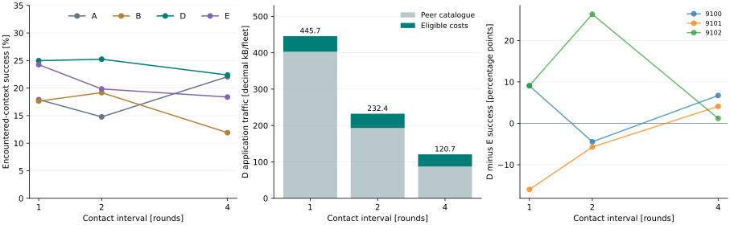

# Communication pilot: promising two-round operation, with a stronger catalogue baseline needed

26 November 2026. Results commit `e2ce6156817ac49cd7c90aca3d1718bf4bb85fbe`.
See the [fixed protocol](../../tracking_communication.md).

**Under the implemented full-catalogue protocol, two-round contact retains
D's average success while cutting its application traffic by 47.86%.**
D beats A in all three two-round programmes. Its added benefit over matched
independent E remains programme dependent. Four-round contact almost removes
the average primary advantage over A.

The communication finding is more specific than a generic compression
benefit: cost records already preserve the exact posterior at low cost,
while repeatedly sending unchanged peer catalogue entries dominates the
remaining bytes. A read-only changed-record diagnostic demonstrates further
savings without making the catalogue stale. That is the appropriate next
communication baseline before interpreting synchronization as the main
volume-saving mechanism.



## Verified scope

The read-only audit reproduces **7,776 paid choices and packet/cache histories**,
reconstructs **all 19 numerical tables**, independently checks **1,373 D/E BO
predictions**, and verifies **6,028 fresh validation rollouts**. Means,
variances and acquisition scores agree within approximately 3.1e-14. The
independent observation-space calculations use the target's own history
through the preceding round and remote histories only through the permitted
contact. All 108 archived source-parity checks pass.

All 18 references are available. Archived calibration labels select references
only; no learner starts with histories. All local caps hold, and no paid or
validation request is numerically unresolved. The validation archive includes
1,486 ineligible rollouts; controllers that failed their paid test remain
in that archive. Every source-result hash is unchanged. No new rollout or
hyperparameter optimization is performed. See [verification.json](verification.json).

This is an exploratory study on one homogeneous plant with programme/noise
seeds 9100/9101/9102 and nine clients per programme: 27 client runs per
method/contact interval. It is not a vehicle-population confirmation or
statistical noninferiority study.

## Control outcomes

Success is the declared within-5%-of-reference rate, averaged over each
client's encountered contexts, then clients and programmes equally. Missing
or ineligible recommendations in encountered contexts remain failures.

| Contact interval | A success | B success | D success | E success |
|---|---:|---:|---:|---:|
| Every round | 17.90% | 17.64% | 24.98% | 24.25% |
| Every 2 rounds | 14.78% | 19.17% | 25.24% | 19.84% |
| Every 4 rounds | 22.06% | 11.90% | 22.38% | 18.37% |

| Contact interval | D minus A | D minus B | D minus E |
|---|---:|---:|---:|
| Every round | +7.07 pp | +7.33 pp | +0.73 pp |
| Every 2 rounds | +10.46 pp | +6.07 pp | +5.40 pp |
| Every 4 rounds | +0.31 pp | +10.47 pp | +4.00 pp |

Every-round D beats A and B in all three new programmes, but its D/E gain
is much smaller than in the earlier dense-gain development programmes.
The new evidence strengthens the practical A/B comparison more than a
uniform added-cost-sharing claim. At four rounds D/E is positive in all
three programmes, but beating E does not replace the primary goal of beating
A. Four-round D loses to A by 9.08 pp in one programme.

Compared with every-round D, two-round D changes average success by +0.26 pp,
reduces failures from 77 to 63, and increases complete eligible policies from
14 to 19 of 27. Its paired mean cost falls 2.59% on nine common complete
policies. However, its success changes are **-8.31/+0.63/+8.47 pp** across
the three programmes. Similar averages do not establish no-loss performance.

Two-round D beats A by **+5.37/+11.57/+14.44 pp**. Against B it is positive
in two programmes and negative by 0.58 pp in the third. Against E its effects
are **-4.45/-5.72/+26.35 pp**: the +5.40 pp average comes from one strong
programme. This remains central to the federated-information claim.

## Feasibility, coverage and conditional cost

Each entry is complete eligible policies out of 27 / failed paid tests out
of 648. A complete policy covers every encountered context with eligible
recommendations; it need not be near-reference everywhere.

| Contact interval | A | B | D | E |
|---|---:|---:|---:|---:|
| Every round | 13 / 91 | 20 / 48 | 14 / 77 | 18 / 73 |
| Every 2 rounds | 13 / 73 | 21 / 54 | 19 / 63 | 20 / 63 |
| Every 4 rounds | 12 / 95 | 15 / 59 | 17 / 77 | 17 / 71 |

Two-round D has nine more failed requests and two fewer complete policies
than B. Its paired mean cost is **6.71% higher than B** on 19 common complete
policies, despite higher near-reference success. Against A and E, paired
cost changes are -15.86% and -15.03% on 12 and 17 common complete policies.
These conditional comparisons do not erase the B tradeoff.

All 63 two-round D failures occur at 0.1 Hz. D's low-frequency success remains
about 1.23%, versus 11.05% for B. The hard-context discovery problem remains;
the independent exact-posterior checks exclude remaining kernel truncation
as its explanation. Two-round D has eleven encountered contexts without
a local incumbent and two additional recommendations failing held-out
eligibility. Missing coverage is not solely absence of local eligible trials.

## Implemented communication protocol

Mean decimal kB per fleet/arm across the three programmes. Used traffic
arrives before the final paid decision; all traffic includes the final flush.

| Contact interval | D peer kB used | D cost kB used | D total kB used | D packet deliveries used | D total kB including final flush |
|---|---:|---:|---:|---:|---:|
| Every round | 402.70 | 43.02 | 445.73 | 828 | 476.61 |
| Every 2 rounds | 193.09 | 39.30 | 232.39 | 396 | 264.79 |
| Every 4 rounds | 87.28 | 33.44 | 120.72 | 180 | 156.32 |

Two-round contact reduces D's used bytes by **47.86%** and packet deliveries
by **52.17%**. Including the final flush, reductions are **44.44%** and **50%**.
Four-round used reductions are 72.92% and 78.26%, with a weaker primary D/A result.

Full-programme eligible D cost records average 190.33/195/190.33 at k=1/2/4.
In particular, k=1 and k=4 send the same average number of labels: all-programme
cost traffic changes from 44.98 to 39.79 kB through fewer headers. Some
used-record reduction at longer intervals is simply a later final flush.
The large total savings principally reflect fewer full-catalogue publications.

The catalogue is **90.35%** of every-round D traffic and **83.09%** at two
rounds. Dense Gaussian messages are an unnecessarily expensive baseline
once permitted scalar summaries reproduce the inference. The separate
archived equivalence audit preserves all 2,592 previous choices and reduces
the legacy model estimate of 12.31 MB to 44.02 kB of compact application
packets. That comparison is an analytical legacy payload versus actual
compact serialization, not two measured network stacks.

D2 also exceeds every-round A by 7.33 pp with 40.53% fewer bytes and 4.35%
fewer packet deliveries. This descriptive configuration comparison changes
both method and contact interval; matched D/E remains the sharing control.
Packet headers and every recipient are counted; IP/TLS, acknowledgements,
loss, latency and provisioning are outside the experiment.

## Posthoc exact changed-catalogue diagnostic

The audit independently reconstructs each full catalogue, serializes only
changed records, and applies those changes to persistent receiver caches.
**All 504 contact caches match the full-catalogue entries exactly.** Donor,
trial, gain/context, source mode and float64 cost are preserved. Empty packet
headers, all recipients and the existing cost channel remain charged.

| Contact interval | D current total kB used | D total kB with changed catalogue records only |
|---|---:|---:|
| Every round | 445.73 | 88.93 |
| Every 2 rounds | 232.39 | 80.55 |
| Every 4 rounds | 120.72 | 69.20 |

These are **posthoc serialized-byte estimates with cache-equivalence checks**,
not a new live protocol result. Contact times and packet counts do not
change. The fixed-membership, persistent-cache simulation needs no deletion
or rejoining mechanism; those mechanisms are outside this diagnostic.

Every-round changed-catalogue exchange would use fewer bytes than the current
four-round full-catalogue protocol. After removing unchanged entries, the
k=2 versus k=1 used-byte reduction is about **9.4%**, rather than 47.9%, while
packet/contact reductions remain. Saving bytes and reducing synchronization
opportunities are separate questions.

## Decision and storyline

Retain k=2 as a candidate **within the implemented full-catalogue protocol**,
with k=1 as reference. Do not promote k=4 or declare k=2 optimal/noninferior.

The next communication step should be **lossless changed-catalogue exchange
at fixed contact times**, checked against frozen decisions. This establishes
an efficient baseline before attributing a volume benefit to stale information
or adding lossy/event-triggered model compression. It can first be tested
by archive replay without new control queries. Then freeze that representation
and confirm D/A, D/B and especially D/E on additional fresh matched k=1/2
programmes, retaining the primary goal of beating A and then B.

The supported story is useful online fleet cost information under a local
trial cap, exact compact exchange, persistent catalogues removing redundant
traffic, and a programme-dependent effect of limited contact opportunities.
This study does not establish uniform sharing benefit, heterogeneous-fleet
generalization, lossy compression gains or real-network robustness.

## Reproduce

```powershell
python code/scripts/analyze_tracking_communication.py --workers 3
```

The script writes analysis tables and figures here, while checking unchanged
source-result hashes. It replays decisions/packets with logged A/B fit states,
independently checks causal D/E predictions, reconstructs all numerical tables
and evaluator inputs, and repeats the changed-catalogue cache diagnostic.
No new physical simulation is allowed.
