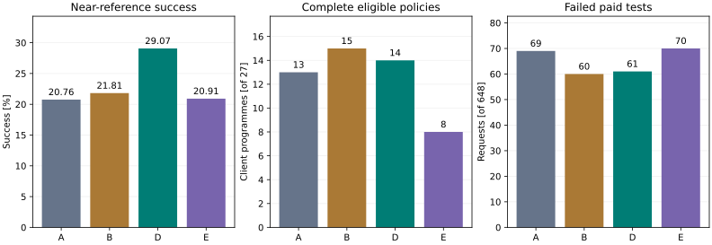
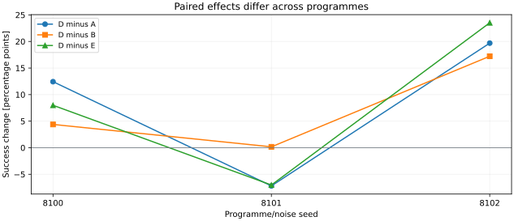

# Dense-gain online BO: useful average sharing benefit, with programme dependence

26 November 2026. Results commit
`a7955c4d730fe0dc26642cf6e22ab0c58eea4ff4`.
The [fixed protocol](../../tracking_dense_gain.md) compares A/B/D/E on the
same 1,292-controller pool, with a genuine K_y extension, empty histories,
24 paid requests per client and the common paid peer-first rule.

**D beats A, B and matched E on the declared average success metric.** The
gains are 8.31, 7.26 and 8.16 percentage points, respectively. D also has
fewer failed tests and more complete eligible policies than A/E in aggregate.
Against B, it incurs one extra failed test and has one fewer complete policy.

The result supports retaining exact shared/local D as the statistical
reference for communication work. The claim remains an average homogeneous
pilot benefit: D loses to A and E in one programme, low-frequency discoveries
are late and scarce, and conditional cost comparisons have small denominators.
The evidence does not establish reliable complete near-optimal commissioning
or universal superiority. No communication experiment is implemented here.



## Audit and scope

The read-only audit reconstructs **all 2,592 paid decisions** across three
programmes and **all 13 saved numerical tables**. A/B restore their logged
pre-query GP fit states, with fresh optimization prohibited. D/E choices are
recomputed from their own earlier paid histories, including the common
round barrier and exact-context peer priority. No controller is resimulated.

An independent observation-space calculation also checks **all 437 D/E BO
predictions**: 211 D and 226 E requests. It reconstructs means, variances,
sharing weights and acquisition scores from earlier-round eligible labels.
Maximum mean, variance and weight discrepancies are approximately
5.2e-14, 4.3e-15 and 2.5e-15. The actual recorded predictions therefore agree
with the exact target GP, beyond the synthetic preflight checks. The weak
contexts are not explained by a remaining spectral truncation error.

The 46,512 archived calibration observations are checked and used only for
reference selection. The 108 archived source-parity observations and input
fingerprints agree. Every paid gain and reference is included in the fresh
validation union: **3,076 rollouts**, or 769 candidate/context pairs with
four repeats each. All 18 references are available. No paid or validation
rollout remains numerically unresolved. Of the validation rollouts, 720 are
ineligible under the frozen task/state checks; these include gains that had
already failed their paid tests and are not discarded from the archive.

Every source-result file retains its hash. The
[verification record](verification.json) includes the table checks, direct-GP
scope and input fingerprints. Reproduce without fresh optimization or rollout:

```bat
python code/scripts/analyze_tracking_dense_gain.py --workers 3
```

This is an exploratory three-programme/noise-seed comparison on one common
compact plant. Programmes are seeds 8100/8101/8102; they are not independent
vehicle populations. Clients encounter 13.81 of 18 contexts on average
(range 10–17), and 5.85 of six speeds (range 5–6). The final denominator is
373 encountered client/context pairs per method. Missing local recommendations
remain failures; unvisited contexts are separate.

## Final outcomes under the 24-request local cap

Primary success averages encountered contexts within clients, then clients
and seeds equally. Pooled counts are provided separately and need not give
exactly the same percentage. A complete eligible policy has a validated
feasible recommendation for every context that client encountered; it does
not require every recommendation to be near the empirical optimum.

| Method | Primary context success | Pooled successful contexts | Complete eligible policies | Failed paid requests |
|---|---:|---:|---:|---:|
| A | 20.76% | 77/373 | 13/27 | 69/648 |
| B | 21.81% | 80/373 | 15/27 | 60/648 |
| **D: exact shared/local** | **29.07%** | **107/373** | **14/27** | **61/648** |
| E: exact independent | 20.91% | 77/373 | 8/27 | 70/648 |

| Contrast | Primary success change | Positive seeds | Common complete eligible policies | Paired mean-J change |
|---|---:|---:|---:|---:|
| D − A | +8.31 pp | 2/3 | 11 | −6.02% |
| D − B | +7.26 pp | 3/3 | 8 | −23.51% |
| D − E | +8.16 pp | 2/3 | 5 | −20.82% |

Cost comparisons condition on complete eligibility for both methods. They
are not unconditional reductions over all 27 client programmes. The D/E
comparison has only five common complete policies, and none in seed 8100.
The aggregate D/A cost advantage also changes sign in seed 8102: D's mean J
is 21.11% higher on its three common complete policies, despite higher
near-reference success. The cost and threshold objectives remain distinct.

## Seed dependence is material

| Seed | D − A success | D − B success | D − E success | D complete policies | D failed tests |
|---:|---:|---:|---:|---:|---:|
| 8100 | +12.43 pp | +4.38 pp | +7.99 pp | 2/9 | 35 |
| 8101 | −7.19 pp | +0.17 pp | −7.02 pp | 9/9 | 3 |
| 8102 | +19.69 pp | +17.22 pp | +23.52 pp | 3/9 | 23 |



Seed 8101 is not a general feasibility collapse. D is the only arm with
complete eligible policies for all nine clients in that programme, and it
incurs only three failed requests. Its paired mean J is lower than A, B
and E on the available common complete subsets. Nevertheless, its declared
5% success rate loses to A and E. Conversely, seed 8102 has strong success
advantages while its paired cost against A is higher. These are substantive
objective and coverage tradeoffs rather than a failed implementation.

A post-hoc diagnostic retains the same recorded policies and varies only
the evaluation tolerance to 2.5%, 10% and 20%. D's aggregate advantages over
A/B/E remain positive at each tolerance. Seed 8101 still loses to A and E
at both 2.5% and 10%; its signs turn positive at 20%. Thus its adverse sign
cannot be dismissed as a tiny 5%-threshold crossing. The declared metric
remains 5%, and these diagnostic thresholds do not replace it or establish
confirmation. Full effects are exported in
[posthoc_threshold_sensitivity.csv](posthoc_threshold_sensitivity.csv).

## Where the average benefit comes from

These frequency percentages pool encountered contexts within the frequency,
rather than using the overall primary equal-client weights.

| Method | 0.1 Hz, 126 contexts | 0.3 Hz, 127 contexts | 0.6 Hz, 120 contexts |
|---|---:|---:|---:|
| A | 0/126 (0.00%) | 19/127 (14.96%) | 58/120 (48.33%) |
| B | 0/126 (0.00%) | 19/127 (14.96%) | 61/120 (50.83%) |
| D | 2/126 (1.59%) | 21/127 (16.54%) | 84/120 (70.00%) |
| E | 0/126 (0.00%) | 9/127 (7.09%) | 68/120 (56.67%) |

Most of D's advantage over A and B is at 0.6 Hz. Against matched E, it also
improves the 0.3 Hz result. The expanded low-frequency tuning opportunity is
real but is rarely solved online. D has 111 locally/validation-eligible
final recommendations among the 126 low-frequency contexts, yet only two
meet the target. The median relative gap among those eligible recommendations
is 87.17%. This is not mainly a missing-incumbent or rounding issue.

D actively probes the wider region: 67 of its 95 BO tests at 0.1 Hz have
K_y above 0.05, compared with 23/100 for E, 31/91 for A and 38/94 for B.
Only D produces paid near-reference discoveries at this frequency:

- Seed 8100, round 23, 22 m/s: g1166, gains approximately
  [0.09096, 0.39514, 0.01228].
- Seed 8102, round 24, 28 m/s: g1601, gains approximately
  [0.08283, 0.45813, 0.02978].

Both are genuine exterior K_y controllers. Their timing leaves little or no
opportunity for later exact-context peer verification within the cap; each
appears only once as a near-reference paid trial. Seed 8101 has no such
discovery. The audit supports saying D can find useful new-range controllers,
not saying it exploits that opportunity reliably within 24 requests.

## Paid-query allocation, failures and shared information

| Method | BO requests | Eligible BO requests | Near-reference BO requests | Peer verifications | Near-reference peer requests |
|---|---:|---:|---:|---:|---:|
| A | 235 | 171 | 18 | 386 | 67 |
| B | 236 | 181 | 28 | 385 | 73 |
| D | 211 | 155 | 46 | 410 | 99 |
| E | 226 | 162 | 29 | 395 | 73 |

Each arm also has 27 factory tests, including the same five failures and six
near-reference outcomes. All 410 D peer verifications are paid and online
eligible. Its 56 failed BO requests comprise 52 at 0.1 Hz and four at 0.3 Hz;
there is no failed D BO request at 0.6 Hz. Its seventeen missing final
eligible context recommendations all lack a locally tested eligible gain;
none is caused by a selected gain newly failing held-out validation.

D has both more successful BO requests and a more useful peer catalogue in
aggregate. These counts are endogenous consequences of each method's own
online history. They do not isolate a direct-query-only treatment effect.
The matched D/E comparison measures the total consequence of sharing cost
information beyond the common peer rule, including subsequent catalogue
and peer-transfer changes.

The exact Gaussian model favors the fully shared component at the final
fit in all three programmes. Its active support has 50, 60 and 49 distinct
eligible inputs, respectively. This is expected evidence about one
homogeneous plant; it does not resolve the earlier heterogeneous D/E gap.

An existing information-use limitation persists: ten of D's 56 failed BO
requests follow an earlier-round failure by a peer at the same exact
gain/context, all at 0.1 Hz. This is descriptive, not a claim that a new
policy would save ten tests. Failed-test information remains local to the
eligibility predictor and is not shared by the cost model. A communication
study should not claim to have solved this separate feasibility-learning issue.

## Consolidation and the communication decision

The result is a useful statistical reference: D leads all three average
success comparisons, and its aggregate failure/coverage profile improves
over A/E, with only a one-test/one-policy tradeoff to B. Together with exact
GP verification, this is sufficient to **freeze the current method and
start defining a communication study under the limited average-benefit claim**.
There is no need to choose another task, gain range, kernel or bonus now.

The current evidence does not support a uniformly better commissioning
method. The positive-every-seed and practical-no-tradeoff descriptive checks
do not all pass. Publication-level robustness claims need fresh fixed-protocol
confirmation; three programme/noise replicates on one plant remain exploratory.
That confirmation can be included in the eventual fixed communication
evaluation rather than introducing another tuning variant.

Communication work should preserve this exact D reference, including seed
8101 and the difficult 0.1 Hz contexts. First define what information clients
may exchange. The observation is already a scalar cost plus a public
gain/context ID, and the peer channel already publishes incumbent gains
and costs. Dense Gaussian-message exchange has not been established as
necessary or more private than compact trial summaries. Where such summaries
are allowed, they are a necessary communication reference.

The next concrete question is how much communication is required to retain
the exact posterior and decision quality, then whether that fidelity
survives closed-loop online data acquisition. Communication reduction
should be assessed against the fixed statistical reference, with all paid
failures, eligibility coverage and reference denominators retained. No
communication advantage is claimed by this audit.
