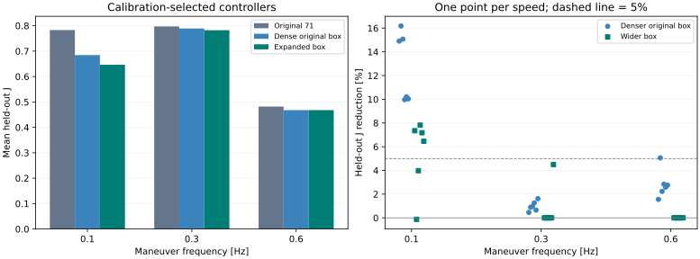

# Gain-domain audit: improve coverage and extend the lateral-error gain

25 November 2026. Results commit
`ff83d777c7697850cd7c1ec1a0cda72ec85e10d7`.
The [prespecified protocol](../../tracking_gain_domain.md) separates refinement
inside the original physical gain box from a genuine extension outside it.

**The original 71-point pool was too coarse to serve as a general optimum
reference. Its upper K_y bound also excluded useful controllers. The evidence
does not show a corresponding need to increase the K_psi or K_r upper bounds.**
The effects are concentrated at 0.1 Hz, and do not resolve the previously
observed 0.3 Hz discovery gap. This is an offline search-domain diagnosis;
no online BO method or federated-versus-local comparison is rerun here.



## Audit, protocol and denominators

The read-only analysis verifies all **72,396 calibration observations**:
2,556 reused observations and 69,840 new ones. It verifies the 108 archived
source-parity observations and all **348 fresh validation observations**.
All six saved numerical tables are reconstructed and agree. Independent
aggregation of the raw rows reproduces eligibility, the calibration-only
winners and their held-out costs. The physical cost is checked directly as
RMSE_y / 0.25 m + applied steering-rate RMS / 10 deg/s.

The audit preserves every source-result file and runs no simulator, optimizer
or spectral-basis construction. One signed Windows manifest path uses
backslashes. The analysis canonicalizes path separators solely when comparing
the generated and saved specifications, verifies the original signature and
source hashes, and retains the raw manifest unchanged. No design or observed
outcome differs. The original runner's strict signature check is not relaxed.

The three sets are nested: original 71, dense original 1,033, and expanded
2,011. The middle set contains 1,024 Sobol points, seven original common
scalings and two probes on the old upper faces. Thus its effect includes
sampling the old boundary explicitly, as well as denser interior sampling.
The expanded set adds only the 978 points outside the original box. Nominal
gains remain [0.005, 0.1, 0.1]; actual upper bounds increase from [0.05, 1, 1]
to [0.15, 3, 3], while lower bounds remain [0.0005, 0.01, 0.01].

All stages use the same two calibration repeats. Their eligible minimum-J
controllers are fixed before receiving four fresh common validation repeats.
There is no validation-based fallback or reselection. Every stage's selected
controller is validation eligible in all 18 contexts, so the cost comparisons
use the same complete set of six speeds and three frequencies. Reported means
weight those 18 contexts equally. Four noise repeats on one plant do not
constitute independent-fleet confirmation.

Reproduce the audit without new rollouts:

```bat
python code/scripts/analyze_tracking_gain_domain.py
```

The [verification record](verification.json) contains the input fingerprints,
table checks, source signature and scope. Diagnostic data are saved alongside
this report; the original [generated HTML report](../../../code/results/tracking_gain_domain_v1/report.html)
and raw batches remain in the result archive.

## Resolution and extension both matter, in different amounts

| Candidate set | Mean held-out J | Reduction from preceding stage |
|---|---:|---:|
| Original 71 | 0.68738 | — |
| Dense original box, 1,033 | 0.64720 | 5.85% |
| Expanded box, 2,011 | 0.63221 | 2.32% |

The total reduction in mean J from original to expanded is **8.03%**.
The original-box refinement lowers held-out J in **18/18 contexts**, by at
least the declared 5% in **7/18**. Of those seven, six are at 0.1 Hz and one
is at 0.6 Hz. The added exterior points lower J in **6/18 contexts**, by at
least 5% in **4/18**. All four material extension effects are at 0.1 Hz.

| Maneuver frequency | Original mean J | Dense mean J | Expanded mean J | Density reduction | Additional extension reduction |
|---|---:|---:|---:|---:|---:|
| 0.1 Hz | 0.78317 | 0.68439 | 0.64643 | 12.61% | 5.55% |
| 0.3 Hz | 0.79729 | 0.78926 | 0.78226 | 1.01% | 0.89% |
| 0.6 Hz | 0.48168 | 0.46795 | 0.46795 | 2.85% | 0.00% |

Percentages in this table are reductions in the frequency-specific mean J,
not means of individual percentage reductions. The overall stage means are
also calculated before taking their ratio.

At 0.1 Hz, the total reduction is **17.46%**. Increasing gain resolution and
the K_y range improves tracking while accepting a higher steering-rate cost:
mean lateral RMSE falls from **15.52 cm to 9.93 cm**, and steering-rate RMS
increases from **1.62 to 2.49 deg/s**. All selected controllers have zero
feedback, total-steering and steering-rate clipping in these validation
rollouts. Their lower J is not an artifact of saturating those limits.

Extension is not uniformly beneficial even after calibration selection. At
22 m/s and 0.1 Hz, its winner has 7.73% lower calibration J than the dense
winner, but **0.13% higher held-out J**, with two positive and two negative
repeat signs. At 24 m/s and 0.1 Hz the held-out gain is 3.98%, below the
material threshold. At 30 m/s and 0.3 Hz the gain is 4.49%. Eleven contexts
retain exactly the dense-original controller. These exceptions remain in
the common denominator.

## The binding old upper bound is K_y

Seven of 18 expanded-stage winners lie outside the old box. **All seven
exceed the old K_y cap of 0.05; none exceeds K_psi = 1 or K_r = 1.** Across
all expanded-stage winners, K_y ranges from 0.000870 to 0.098873, K_psi from
0.024947 to 0.878053, and K_r from 0.011517 to 0.372887. The selected exterior
K_y values at 0.1 Hz lie between 0.060 and 0.083. None selects the new hard
upper limit K_y = 0.15.

The controlled profiles support this distinction:

- Holding the other gains of g012 fixed, K_y = 0.06 improves validation J
  over K_y = 0.05 at all six speeds. K_y = 0.10 remains eligible across all
  repeats at 20 and 22 m/s, but loses complete validation eligibility at
  the four higher speeds. K_y = 0.15 fails the state guard in all 24 profile
  validation rollouts.
- Holding the other gains of g030 fixed at 0.3 Hz, increasing K_psi through
  1.2, 2 and 3 worsens J at every speed, while these profile points remain
  eligible. A controller can be feasible and still be less useful.

These are retrospective, one-coordinate profiles of two previously useful
controllers. They do not rule out every joint gain interaction. There is
also no controlled K_r profile in this audit. The absence of selected
K_psi/K_r values above 1 supports a focused K_y extension as a follow-up
design choice; it is not a proof that those other ranges can never help.
Eight expanded-stage winners remain near an unchanged lower boundary,
principally the K_r floor. Lower-bound adequacy remains untested.

## Wider ranges add failures and numerical difficulty

| Disjoint calibration group | Rollouts | Eligible rollouts | Eligibility rate | Numerically unresolved |
|---|---:|---:|---:|---:|
| Original 71 | 2,556 | 1,974 | 77.23% | 0 |
| New points inside old box | 34,632 | 26,124 | 75.43% | 0 |
| New points outside old box | 35,208 | 19,259 | 54.70% | 6,813 |

These are per-rollout counts; candidate/context eligibility for selection
requires both calibration repeats. Task-infeasible and numerically
unresolved categories overlap, and must not be added as disjoint failures.
An unresolved result is excluded from selection without claiming that it
establishes physical infeasibility.

Among the exterior candidates, 972 candidate/context pairs complete both
repeats within the task limits but lack numerical agreement in at least
one. **None has a lower last-grid mean J than the resolved reference**;
even the smallest such score is over 34 times its context's reference.
Those scores are diagnostic only, and are not accepted as converged costs.
They provide no observed competing low-cost reference in this archive, but
do not certify the unresolved region or continuous-domain optimality.

All 348 validation requests have resolved integration. The 38 ineligible
requests belong to the aggressive K_y profile probes, rather than the
stage-selected winners. This distinction prevents profile stress tests
from being mistaken for failure of the selected recommendations.

## What changes in the scientific story

The completed online A/B/D/E comparisons remain valid **on their declared
71-vector task**. Their empirical reference was a best-found controller in
that finite set. It should not be described as a generally near-optimal
controller over the physically broader domain. The improved offline
reference does not justify reranking methods that were never allowed to
request the new controllers.

The useful range extension is condition dependent. The large gains are at
0.1 Hz, while the 0.3 Hz optimum changes little under either stage. Thus
this audit supplies no evidence that a restrictive K_psi upper cap caused
the earlier 0.3 Hz discovery gap. It also does not demonstrate that a larger
pool will favor federated BO: local and shared learners must both be tested
under the revised search task.

The [calibration-only resolution curve](calibration_resolution_curve.csv)
continues improving from 512 to 1,024 Sobol points. These intermediate
winners were not all independently validated. The 2,011-point results
therefore remain a stronger finite-pool reference, not a convergence or
global-optimum certificate.

For the next online comparison, I recommend fixing a denser public pool
that includes K_y above 0.05, then checking the cost-model representation
on that exact pool before comparing A/B/D/E under the same 24-request cap
and paid peer rule. A focused upper extension in K_y has direct support;
the larger K_psi/K_r ranges add no selected-controller benefit here.
Offline calibration labels must remain evaluator-only, with learning
histories still generated online. The large candidate-by-context grid
also requires a scalable feature construction rather than materializing
the full spectral kernel used for the old 71-point pool.

The next scientific target is whether shared cost information helps beat
A and B in this better-resolved controller search while retaining failure
and complete-policy accounting. Communication tuning can follow that
matched comparison. This analysis does not implement a new online policy,
choose another uncertainty bonus or launch another experiment.
