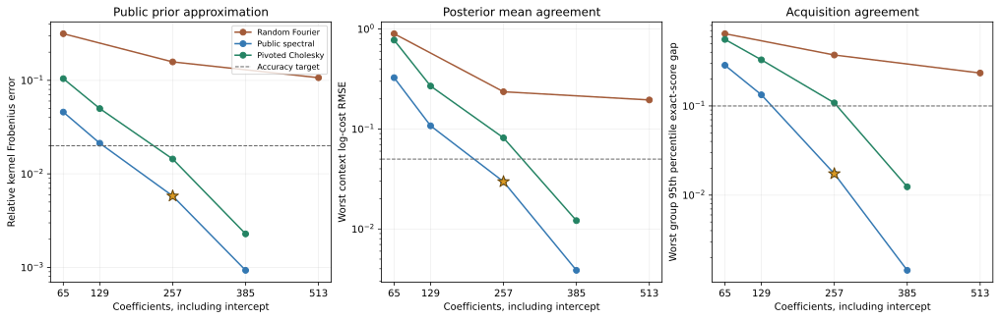

# Public spectral features retain D's model and improve kernel fidelity

24 November 2026. Protocol and accuracy targets:
[tracking_kernel_assessment.md](../../tracking_kernel_assessment.md).
This follows the [low-frequency diagnosis](../low_frequency_rankings/report.md).
It uses the completed controller results without changing them or generating
new rollouts.

## Assessment decision

**Public spectral features are the strongest tested representation. A factor
with 256 spectral terms plus the intercept is the smallest tested map that
meets all declared accuracy targets.** A 384-term map is a useful closer-reference
option, with substantially higher first-choice agreement and higher payload.

D's shared/local Gaussian formulation, sharing prior, observation noise,
kernel hyperparameters and acquisition remain unchanged. The comparison
assesses numerical fidelity to that model's exact kernel; it does not yet
establish that the updated representation beats A or B online.

## Coverage and controls

The assessment compares 12 representations on 12 saved-history jobs: A and D
histories, homogeneous and heterogeneous conditions, and seeds 1100/1101/1102.
All six contexts are included. There are 1,018 actual BO decision prefixes,
giving 12,216 representation/case comparisons. Every fit uses only that
source's earlier paid eligible observations. All alternatives use the same
target eligibility probabilities and untried-context mask.

No dense calibration or validation cost labels enter accuracy measurement,
basis construction or selection. The reference is D's exact posterior and
acquisition on the same saved observations. Alternative rankings do not
provide outcomes or advance the histories. These are development diagnostics
on previously studied fixed fleets, not independent fleet confirmation.

The original 64-random-feature representation reproduces all 537 factual D BO
choices with zero numerical score gap, and its communication calculation
matches the saved D snapshots. A full-rank public factor recovers exact-kernel
predictions to numerical precision. Observation-space and feature-message
inference agree at all tested benchmark prefixes, and six focused unit tests
cover basis construction, inference equivalence and selection guards.

## What changes in the representation

The original 426 gain/context inputs are public. Construct the signal-kernel
matrix before any rollout, and write K_s=U Lambda U^T. The rank-r spectral map is

\[
 F_r=[\sqrt{.25}\,\mathbf1,\;U_r\Lambda_r^{1/2}],
 \qquad K_r=F_rF_r^\top.
\]

The constant term remains exact. Leading signal eigenvectors replace the random
Fourier features; costs, family labels and plant parameters do not select or
fit this basis. D still places shared and vehicle-local Gaussian coefficients
on the same public map and integrates its existing prior over sharing strength.
With r=256 the shared vector and each local vector have 257 coefficients.
The three tuned feedback gains and physical controller are unchanged.

The alternatives are the original generator at 64/256/512 Fourier terms,
spectral maps at 64/128/256/384 terms and the full 426-term check, and greedy
pivoted-Cholesky maps at 64/128/256/384 terms. No seed or kernel-hyperparameter
sweep is used. The spectral and pivoted bases use only the public covariance.

The spectral construction is a reduced-rank kernel representation described in
Rasmussen and Williams, Chapter 8,
[primary text](https://gaussianprocess.org/gpml/chapters/RW.pdf). Its prior-matrix
approximation property does not by itself guarantee posterior or BO accuracy;
those are assessed below on the saved histories.

## Numerical accuracy

Worst-context RMSE means the maximum over the 24 source/condition/context
groups, each pooling its three existing seeds. The score-gap column is the
worst history/condition-group 95th percentile of
s_exact(a_approx)-min s_exact. It is an acquisition-score difference, not
physical controller regret. The targets were fixed before this assessment.

| Representation | Coefficients | Worst mean RMSE | Worst std RMSE | 95th percentile score gap | Passes every target |
|---|---:|---:|---:|---:|---|
| Original random Fourier, 64 | 65 | .8982 | .3640 | .6458 | No |
| Spectral, 64 | 65 | .3263 | .3215 | .2860 | No |
| Spectral, 128 | 129 | .1077 | .1349 | .1334 | No |
| **Spectral, 256** | **257** | **.0297** | **.0407** | **.0174** | **Yes** |
| Spectral, 384 | 385 | .00386 | .00784 | .00144 | Yes |
| Pivoted Cholesky, 256 | 257 | .0816 | .0895 | .1083 | No |
| Pivoted Cholesky, 384 | 385 | .0121 | .0182 | .0124 | No: prior diagonal error |
| Random Fourier, 512 | 513 | .1954 | .0426 | .2341 | No |
| Full spectral check | 427 | <2e-14 | <4e-15 | 0 | Exact recovery |

The 256-term spectral map has .580% relative kernel Frobenius error and 3.56%
maximum prior diagonal error. Overall mean and standard-deviation RMSEs are
.0184 and .0273, respectively. Its worst group mean score gap is .00325 and
worst group 95th percentile gap is .01739, below the declared .05/.10 targets.
Its worst-context mean/std errors are below the existing .05 log-J noise SD.
These are empirical approximation checks, not uniform error guarantees.

No representation with 65 coefficients passes. Spectral truncation improves
on the original random features at that width but still drops too much useful
covariance. Increasing only the random-feature count to 512 is less accurate
than the 256-term spectral map, despite requiring more coefficients.

The 384-term pivoted factor has good conditioned predictions, but its maximum
prior diagonal error is 5.42%, just above the unchanged 5% target. It is not
reclassified as a pass after seeing its other metrics. At the same width the
spectral factor has lower prior and posterior errors.



The figure shows three of the six declared checks. In particular, the prior
diagonal-error check is not plotted. The full-rank sanity check is omitted
from these log-scale curves because its error is at numerical precision.

## Ranking agreement and the difficult context

Overall first-choice agreement with the exact reference is:

| Representation | First-choice agreement | Median score-rank correlation |
|---|---:|---:|
| Original 64 random terms | 5.60% | .500 |
| 256 spectral terms | 79.37% | .9949 |
| 384 spectral terms | 95.19% | .9994 |
| Full spectral factor | 100% | 1.000 |

The 256-term factor does not reproduce every exact decision. Its small score
gaps explain why its numerical checks pass despite different first choices in
about one fifth of cases. Small ranking differences can still alter the later
data and peer catalogue, so these results cannot predict an alternative full
policy's success rate. Per-seed and per-context tables retain the variation.

In the original homogeneous 30 m/s, .1 Hz diagnostic, on D's 56 saved fallback
histories, the useful g012 gain has median rank 39 under the original random
map and rank 8 under the 256-term spectral map, versus rank 9 for the exact
reference. The spectral map ranks it first five times, matching the reference's
count. This check is reported after selection; g012's validation quality is
not a selection criterion.

The same numerical targets also hold across heterogeneous conditions and A
histories. The selected representation is therefore not selected solely for
the low-frequency D history that exposed the problem. This does not constitute
a new unseen-data or independent-fleet test.

## Computation and communication cost

The actual feature-message fit and all-client/all-action predictions were
timed at the prescribed round-23 seed-1101 prefixes, with one BLAS thread:

| Representation | Coefficients | Measured fit/prediction time | Model payload at final decision |
|---|---:|---:|---:|
| Original random map | 65 | about .029 s | 43.6 MB/fleet |
| Spectral, 256 | 257 | about .160 s | 658 MB/fleet |
| Spectral, 384 | 385 | .300--.308 s | 1,471 MB/fleet |
| Full spectral factor | 427 | .360--.404 s | 1,808 MB/fleet |

Payloads average the six actual D source jobs and use the unchanged dense
float64 information-message format, excluding unused final-round training.
They exclude peer publications and transport overhead. The selected factor
raises model payload about 15.1 times; it does not provide a communication
advantage. Broadcasting its full public basis once to nine clients adds a
conservative 7.88 MB. A deployment must share one pinned feature matrix, not
assume independently computed eigenvectors have identical coordinates.

These single-machine timings are not distributed latency estimates. The faster
observation-space calculation used for the accuracy sweep is mathematically
equivalent and does not replace the measured feature-message implementation
cost. No message compression or sparse/low-rank message redesign is included.

## What to carry forward

Carry forward the public spectral family with D's shared/local formulation.
The 256-term map is the smallest tested representation meeting every fixed
accuracy target; the 384-term map is a closer-reference option with 95.2%
first-choice agreement and approximately 2.24 times its model payload. The full
public factor remains an exact finite-grid control.

The next controller comparison should keep A as the primary benchmark and B
as the secondary benchmark, with the existing budget, peer rule and metrics.
Its role would be to test the improved representation in the adaptive loop;
this assessment has neither launched that campaign nor established its result.
The learned model still needs to infer costs from newly generated online
observations; the public feature map supplies covariance structure, not a
historical cost archive.

Reproduce with:

```bat
python code/scripts/assess_tracking_kernels.py --workers 6
python code/scripts/plot_tracking_kernel_assessment.py
```

See [representation_comparison.csv](representation_comparison.csv),
[by_context.csv](by_context.csv), [by_seed.csv](by_seed.csv),
[communication_estimates.csv](communication_estimates.csv),
[feature_inference_benchmark.csv](feature_inference_benchmark.csv), and
[verification.json](verification.json).
