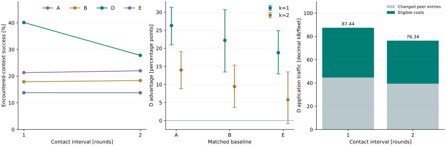
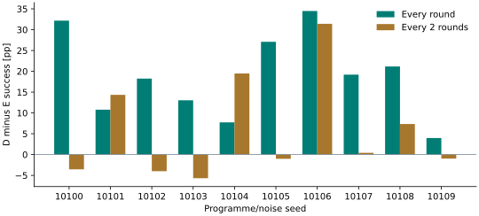

# Lossless catalogue confirmation: strong timely-sharing benefit and sensitivity to contact frequency

26 November 2026. Results commit
`d1ad83c996909f29940c195ffc58fdeb281906e4`.
The [fixed protocol](../../tracking_delta_catalogue.md) uses ten new
programme/noise seeds, 10100–10109, nine homogeneous clients, 24 paid requests
per client/arm, and contact intervals k=1/2. All arms use lossless catalogue
updates, the same paid peer-first rule and their own current local data.

**The predeclared two-round D/A and D/B success comparisons are positive,
while the matched two-round D/E effect remains uncertain. Every-round D,
the predeclared reference, beats A, B and E in all ten programmes.**
The larger study overturns the earlier suggestion that two-round contact
retains D's performance: it loses 12.32 percentage points while saving only
12.69% of application bytes after unchanged catalogue entries are removed.

This supports the core role of timely fleet cost information in the tested
homogeneous task. Retain every-round lossless D as the statistical reference
and consolidate the result before another algorithmic variant.



## Fixed question and outcome weighting

The primary operating point was fixed as k=2 before these outcomes. The
comparison order is D2/A2, then D2/B2 and D2/E2. The one-round arms are
preplanned references; their stronger outcomes do not retroactively change
the primary comparison.

Success means within 5% of the empirical finite-pool reference. It averages
encountered contexts within each client, then clients and programmes equally.
Missing/ineligible recommendations in encountered contexts remain failures.
There are 90 client runs per method/interval, but only ten independent
programme/noise units for the paired uncertainty summaries. No client-level
pseudoreplication is used. The 95% percentile bootstrap intervals below are
descriptive and not multiplicity-adjusted significance or noninferiority tests.

## Final success

| Contact interval | A | B | D | E |
|---|---:|---:|---:|---:|
| Every round | 13.79% | 17.90% | **40.11%** | 21.32% |
| Every 2 rounds | 13.78% | 18.35% | **27.79%** | 22.02% |

| Interval | Comparison | Mean success effect | Descriptive 95% programme interval | Positive programmes |
|---|---|---:|---:|---:|
| Every 2 rounds, primary | D − A | +14.01 pp | +8.81 to +19.07 pp | 9/10 |
| Every 2 rounds | D − B | +9.44 pp | +3.63 to +15.35 pp | 7/10 |
| Every 2 rounds | D − E | +5.78 pp | −0.85 to +13.50 pp | 5/10 |
| Every round, reference | D − A | +26.32 pp | +20.94 to +31.36 pp | 10/10 |
| Every round | D − B | +22.21 pp | +13.46 to +30.71 pp | 10/10 |
| Every round | D − E | +18.79 pp | +12.91 to +24.90 pp | 10/10 |

The minimum every-round programme effects against A/B/E are still positive:
+8.10/+2.60/+3.97 pp. Thus this fresh reference comparison supplies stronger
evidence for added shared cost information than the earlier three-programme
pilot. E has D's matched marginal prior and acquisition bonus, with the same
peer verification rule. D/E therefore tests information sharing beyond that
common controller-transfer mechanism; D/A alone cannot isolate it.



## Two-round contact changes D's result materially

D2 minus D1 is **−12.32 pp**, with descriptive programme interval
**−18.18 to −6.31 pp**. It is negative in nine of ten programmes. Failed
requests increase by 38 and complete eligible policies fall by 18 of 90.
The paired mean cost increases 4.84% on 20 common complete policies.

The corresponding success changes for A, B and E are −0.01/+0.45/+0.69 pp,
with their descriptive intervals spanning zero. D's sensitivity is much
larger than that of these baselines. Both remote channels were slowed
together: this interaction is consistent with the value of timely fleet
information, but it does not separately identify cost-model staleness and
delayed peer-controller availability. The catalogue contents also depend on
the discoveries made by each arm.

The three-programme pilot's D2/D1 average change of +0.26 pp was not stable
on these new programmes. The fixed confirmation should guide the operating
point; no bonus, prior, kernel or gain-pool setting was changed to obtain it.

## Feasibility and conditional physical cost

Each entry is complete eligible policies out of 90 / failed paid requests
out of 2,160. Complete eligibility covers every encountered context, without
requiring every recommendation to reach the near-reference target.

| Contact interval | A | B | D | E |
|---|---:|---:|---:|---:|
| Every round | 47 / 299 | 57 / 224 | 47 / 264 | 46 / 262 |
| Every 2 rounds | 40 / 289 | 49 / 216 | 29 / 302 | 40 / 261 |

Every-round D's stronger success comes with 40 more failed requests and
ten fewer complete policies than B. Its paired mean J is **13.06% higher**
than B on 39 common complete policies. Against A/E it is 2.84%/10.69% lower
on 26/31 common complete policies. Two-round D is 17.74% above B on 22 common
complete policies, while below A/E by 16.77%/5.13% on 22/22 policies.
These conditional comparisons retain their denominators and do not imply
an unconditional cost advantage. D's near-reference success lead is not
uniform superiority on feasibility, coverage and mean physical cost.

The difficult 0.1 Hz condition remains weak. Every-round D succeeds in
**0/405** encountered low-frequency client/context cases, with 259 of its
264 failures occurring at that frequency. Its positive results concentrate
at 0.3/0.6 Hz: frequency-unit mean success is 41.61%/78.70%, versus E's
14.89%/47.28%. These differ slightly from pooled context percentages because
of client weighting. D's two-round rates fall to 18.09%/61.78% there.

No method at either interval achieves near-reference gains for every
encountered context in any complete client run. This is an improvement in
budgeted contextual tuning success, not complete near-optimal commissioning.
Every-round D has 51 encountered contexts with no local incumbent and seven
more with held-out-ineligible recommendations. Two-round D has 75 and three.

## Communication after the lossless correction

Mean decimal kB per fleet/arm. Used traffic is available before the last paid
decision; the all-traffic column includes the unused final contact. Actual
16-byte headers, empty packets and every recipient are counted.

| Contact interval | D changed peer kB used | D cost kB used | D total kB used | Packet deliveries used | D all kB |
|---|---:|---:|---:|---:|---:|
| Every round | 44.62 | 42.82 | **87.44** | 828 | 91.42 |
| Every 2 rounds | 39.34 | 37.01 | **76.34** | 396 | 83.74 |

Two-round contact reduces used bytes by **12.69%** and used packet deliveries
by **52.17%**. Including the final flush, reductions are **8.39%** and **50%**.
For the complete programme, 6,912 of the 7,672 saved bytes are fewer headers;
the remaining 760 bytes reflect fewer eligible D cost records. Average
published changed-peer record counts happen to match across intervals here.
This is a small additional volume gain after eliminating unchanged entries,
with a substantial control-success loss. Fewer packet/contact opportunities
are a distinct possible benefit; no real transport latency, loss or bandwidth
bottleneck is modeled.

Every-round A/B/E use 41.74/44.54/44.57 kB and 414 packet deliveries. D's
additional cost stream therefore has a real communication premium: about
42.87 kB over E, with twice the packet deliveries. The added 18.79 pp of
success is accompanied by that premium, rather than claiming D is cheaper
than local E. The two channels are not multiplexed in the current accounting.

The archived lossless gate separately proves that representation changes
preserve all 7,776 earlier decisions and all recipient catalogues at 504
contacts. The new 40.11% rate must not be attributed to compression: these
are new programmes and a fresh held-out bank, while compression itself is
decision preserving.

## Verification

The read-only analysis reconstructs **all 17,280 paid decisions, 22 saved
numerical tables and the declared primary readout**, checks **3,056 D/E
predictions independently in observation space**, and verifies **12,316
fresh validation rollouts**. Maximum mean, variance and acquisition errors
are about 4.01e-14/9.10e-15/4.01e-14.

All 18 references are available. The 46,512 archived calibration observations
remain evaluator-only, with no historical training labels. All 108 source
parity checks pass. The validation archive contains 3,379 ineligible rollouts
and zero unresolved ones; failed online gains remain in that archive. No
paid request is unresolved, all local caps hold and all source-result hashes
remain unchanged. No new rollout or hyperparameter optimization is performed.
The [verification record](verification.json) gives fingerprints and checks.

## Decision and paper claim

1. **Retain every-round lossless D as the statistical reference.** The
   predeclared k=2 primary A/B comparisons are favorable, while k=1 supplies
   the clearest additional-cost-sharing evidence. Preserve that distinction.
2. **Consolidate the current method and evidence.** A supported claim is that
   timely online fleet cost information improves near-reference controller
   tuning beyond matched local modeling under the same peer-verification
   rule in this homogeneous simulation. Include the B feasibility/cost and
   low-frequency limitations.
3. **For later communication work, isolate the channels before adding loss.**
   Keep the lossless protocol fixed and separately vary cost-model and peer
   catalogue contact schedules to identify the source of sensitivity. This
   is a future diagnostic, not a result of the current coupled schedule.

Ten programme/noise seeds on one plant do not establish heterogeneous-fleet
generalization. The allowed exchange contains scalar trial records, with no
raw trajectories or failed labels; it does not establish parameter-only FL
or stronger privacy guarantees. Earlier adaptively developed studies are
kept separate rather than pooled into this fixed confirmation.

## Reproduce

```powershell
python code/scripts/analyze_tracking_delta_catalogue.py --workers 3
```

The script writes analysis artifacts here while preserving every source
result. A/B use their logged fit states, D/E choices are replayed, independent
GP calculations respect each client's permitted information age, and the
validation union, uncertainty tables and primary readout are reconstructed.
