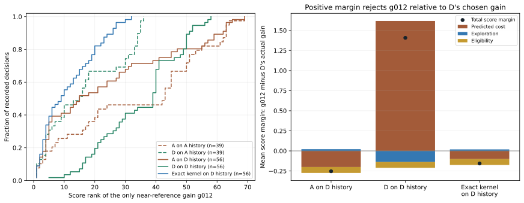

# Low-frequency failure: cost ranking and the kernel approximation

24 November 2026. This follows the
[joint-model results](../joint_shared_local_cost_model/report.md), using the
same completed campaign (`47e8ee396eddf7379ddb463c5c318c7ae9d2f8e2`).
The focus is the homogeneous fleet at 30 m/s and .1 Hz. No controller rollout
or alternative full BO policy is run. The heterogeneous D/A result and all
previous primary metrics remain unchanged.

Follow-up: the [kernel assessment](../kernel_representation_assessment/report.md)
compares public spectral, pivoted-Cholesky and larger Fourier maps on both
conditions and A/D histories. It selects a 256-term spectral map under fixed
accuracy targets and quantifies its additional message cost. No new online
controller result is implied.

## Main finding

**On D's saved histories, its predicted cost ranking suppresses the useful gain.
The uncertainty and eligibility terms favor that gain on average. Replacing the
finite feature kernel with its exact intended kernel substantially improves
the rankings on those same observations.** This identifies a kernel-approximation
contribution to this ranking failure, without establishing an improved full
online policy or explaining every part of the homogeneous D/A gap.

The next modeling step should preserve the shared/local formulation and assess
its kernel representation against an exact reference before another full BO
campaign. These results do not motivate changing the plants, threshold, peer
rule, query cap or exploration coefficient to reverse the ranking.

## The near-reference result depends on discovering one gain

The frozen validation bank has exactly one gain within the declared 5% threshold
in this context: `g012`, also the calibration-selected reference. Its validation
mean J is .82484. The next-best eligible candidate, `g068`, has J=1.05092, a
27.41% gap, so it cannot qualify under that threshold. This is a finite-pool
discovery result; the 27 homogeneous clients/seeds do not represent independent
physical fleets.

`g012` multiplies the factory [Ky, Kpsi, Kr] gains by approximately
[8.325, 4.116, .150]. These descriptors and validation labels are evaluator
metadata and are not supplied to the learners.

| Actual source | BO fallback tests | Eligible BO outcomes | g012 BO discoveries | g012 peer verifications | Final near-reference contexts |
|---|---:|---:|---:|---:|---:|
| A | 44 | 20 | 3 | 13 | 16 / 27 |
| D | 56 | 13 | 0 | 0 | 0 / 27 |

A discovers g012 twice in round 19 of seed 1101 and once in round 15 of seed
1102. Those three discoveries and 13 later peer verifications account for its
16 final successes. D never tests g012 in this context, so the common peer rule
has no such incumbent to distribute. This is not a failure to verify an
available successful peer gain.

D does test g012 at 20 m/s, .1 Hz in seed 1102, beginning in round 18, with
eight subsequent paid verifications there. Thus some late D decisions already
have cost-model information about the same gain at the other speed. That does
not establish its local eligibility at 30 m/s; a test there is still required.

## Factual replay and comparisons on identical source histories

For each saved homogeneous A or D fleet trace, replay the chronological sequence
of actual source observations. At each BO decision:

- Fit A's original target-only GP, retaining its prescribed kernel-refit cadence.
- Fit D's original shared/local model on that source fleet's eligible records.
- Use the same target history for eligibility and the same untried context mask.
- Rank candidates with the existing acquisition coefficients. Only the actual
  source's recorded observation advances the next history.

This controls the adaptive history being used; it does not equalize the original
models' information access. A still uses target costs and D still uses eligible
fleet costs. Alternative rankings generate no new observation and never alter
later fits. They are not replays of alternative closed-loop policies.

All 239 factual homogeneous A BO choices and 284 factual homogeneous D BO choices
are reproduced, including decisions in other contexts needed for A's refit
schedule. The target context contributes 44 A and 56 D fallback decisions.
In five A cases g012 was already tested locally and is correctly unavailable;
its reference-rank statistics exclude those cases. It remains available in all
56 D cases.

Finite-difference optimizer refits differ slightly across platforms: the maximum
archived/recomputed A log-kernel-parameter difference is 9.34e-5, below the
declared 1e-4 replay tolerance. Every factual A action still matches exactly.
The diagnostic does not change A's optimizer settings.

| Saved history source | Fitted model | Cases with g012 available | Median g012 score rank | g012 ranked first | g012 in top five |
|---|---|---:|---:|---:|---:|
| A | A | 39 | 43 | 3 | 7 |
| A | D | 39 | 15 | 4 | 12 |
| D | A | 56 | 15 | 5 | 20 |
| D | D | 56 | 39 | 0 | 1 |

D ranks g012 more favorably on A's saved histories than on its own. Therefore
this is not a history-independent statement that D always rejects the gain.
It exposes an interaction between the model and its adaptively selected data.
On D histories, the median predicted-mean rank alone is 40 for D versus 8.5 for
A. The bad score ranking is already present in the cost predictions.

## Which score term rejects g012?

For actual D gain a and reference g, decompose the score margin as

\[
 s(g)-s(a)=[\mu(g)-\mu(a)]-2[\sigma(g)-\sigma(a)]
           -[\log p(g)-\log p(a)].
\]

A positive margin rejects g012 relative to D's actual gain. The log-probability
floor is applied exactly as in the frozen acquisition. Across the 56 D-history
fallbacks, the mean margins are:

| Fit on D history | Predicted-cost term | Exploration term | Eligibility term | Total |
|---|---:|---:|---:|---:|
| A | -.201 | +.021 | -.074 | -.254 |
| D | +1.618 | -.137 | -.074 | +1.407 |
| Exact-kernel reference below | -.101 | +.019 | -.074 | -.156 |

For D, both the exploration and eligibility terms favor g012 in the aggregate;
the predicted-cost difference overwhelms them. This is a paired score
decomposition on those observed decisions, not a causal test of a changed beta
or eligibility model. Individual cases can have different term signs.

For example, the largest A/D reference-rank disagreement occurs in seed 1101,
round 21, client 05. D selects `g047`, which is ineligible in the validation
bank. It predicts log cost 1.901 for g012 and -.210 for g047. Their eligibility
probabilities are .637 and .529 respectively, so eligibility favors g012.
D ranks g012 58th; A fitted on the same source history ranks it second.
The example is selected by rank disagreement, not by alternative validation
performance; full candidate terms are provided in the example CSV.

## Matched exact-kernel reference

The extra analytical control keeps D's sharing prior, noise, fixed length
scales, amplitude, constant variance, eligible fleet observations and mixture
prediction rule. It changes only the base covariance from the finite random
features to the exact public Matérn-5/2 kernel plus the constant term:

\[
 k_\rho((x,i),(x',j))=
 [\rho+(1-\rho)\mathbf1_{i=j}]k_0(x,x').
\]

No kernel hyperparameter is optimized. Each sharing component is conditioned
jointly on the same paid observations; its marginal likelihood updates the same
public rho prior. A unit test verifies that this dense calculation recovers D's
feature-space posterior when its base kernel is replaced by exactly F F^T.
This checks that the reference is isolating kernel representation, rather than
using a different likelihood or double-counting labels.

| Model on the same 56 D histories | Median g012 score rank | g012 ranked first | g012 in top five | Top-ranked gain eligible on validation |
|---|---:|---:|---:|---:|
| A: adapted local GP | 15 | 5 | 20 | 27 / 56 |
| D: 64 random features + intercept | 39 | 0 | 1 | 13 / 56 |
| Exact-kernel reference | 9 | 5 | 22 | 43 / 56 |

Sharing-fraction changes are small: the maximum absolute difference in posterior
expected rho between D and the exact reference is .00241 over these cases.
The ranking improvement does not result from switching cost sharing off.

The five first-ranked g012 cases for the exact reference all occur in seed 1102,
rounds 22--24, after D has observed g012 at the other speed. It does not rank
g012 first in every seed, and it does not establish that a full exact-kernel
policy would reproduce A's earlier discoveries or beat A. Alternative top-rank
eligibility uses the frozen validation bank, not simulated outcomes at the
original query-specific noise seeds.

The feature-space inference is mathematically correct for its represented
kernel. The finding concerns the adequacy of this particular 64-feature
approximation after conditioning on these histories, not an identified error
in the Bayesian update or evidence that random features generally fail.



Ranks include the original untried-gain mask; first place includes ties. The
plot summarizes repeated decisions on three fixed programme/noise seeds and
does not supply independent-sample confidence intervals.

## Repeated failures are an additional information limitation

Thirteen of A's 44 fallback tests and 24 of D's 56 occur at a gain/context where
another client already had a failed observation in a previous round. D also
tests fewer distinct BO gains despite making more BO requests in two seeds:
9 versus 6 unique gains for A/D in seed 1100, 7 versus 7 in 1101 and 7 versus 6
in 1102.

These are evaluator observations of the saved fleet history. Cost sharing uses
eligible costs only, and eligibility learning remains target-only. Failed peer
tests do not directly train either D's shared cost model or another target's
eligibility model. The repeats expose that information boundary, but they do
not show that sharing or banning failed gains would improve the full policy,
particularly for heterogeneous plants with different eligibility regions.

## Decision before another experiment

Retain the positive heterogeneous D/A finding and keep A as the homogeneous
benchmark. The present diagnostic gives a concrete reason to assess the cost
kernel approximation before changing the statistical sharing model or the
control problem. A richer federated representation should first reproduce
the exact-kernel predictions and rankings adequately on these fixed histories;
its feature dimension and communication cost require explicit justification.

Do not infer that more features automatically beat A, that changing the
exploration coefficient solves the failure, or that the exact-kernel control
is already a federated deployment. A full matched campaign remains necessary
to assess an updated representation's online performance, including the
heterogeneous comparison against B.

Reproduce the audit, rankings and figure with:

```bat
python code/scripts/analyze_tracking_rankings.py
```

See [ranking_summary.csv](ranking_summary.csv),
[decision_rankings.csv](decision_rankings.csv),
[discovery_and_repetition.csv](discovery_and_repetition.csv),
[example_full_rankings.csv](example_full_rankings.csv), and
[verification.json](verification.json).
