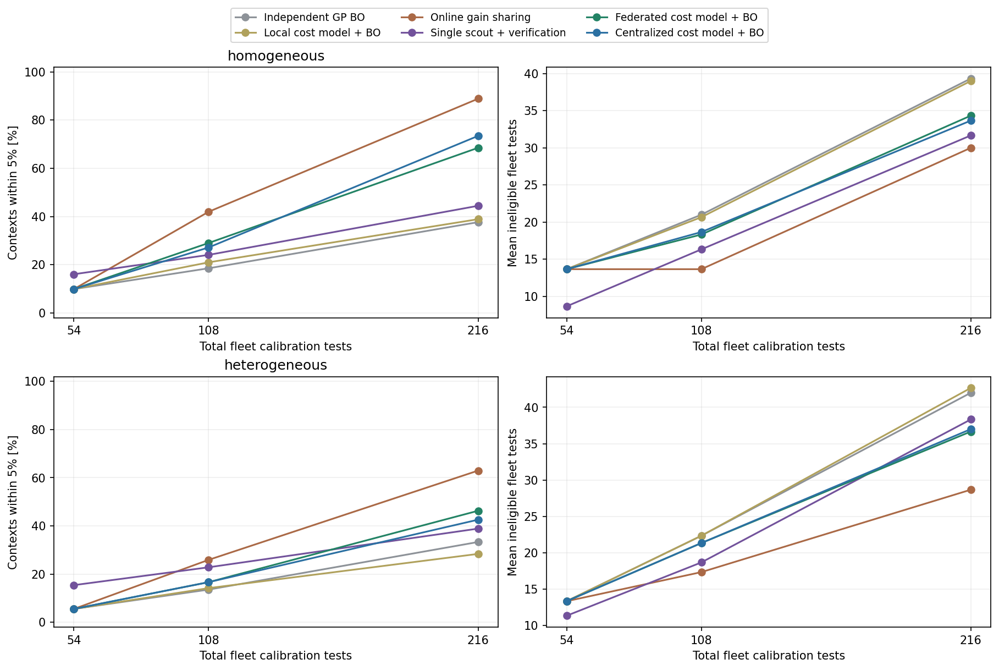

# Online contextual calibration: first pilot analysis

23 November 2026. Results commit: `11f3dedfed2009c4e15270087bf6bf05dfdc1160`.
Protocol: [tracking_online.md](../../tracking_online.md).

Online information sharing helps from an empty starting history. A shared learned
cost mean improves on independent calibration, particularly with identical
vehicles. However, exchanging currently useful gains is the strongest practical
baseline on aggregate context coverage, experiment failures and available cost
comparisons. Its advantage survives heterogeneous dynamics. The current evidence
does not establish added value for training the cost model beyond this simpler
information exchange.

## Verification

All six jobs and 7,776 charged rollout requests pass checkpoint validation.
The shared simulation cache contains 5,225 distinct counterfactual rollout
records; cache/batching savings never reduce a method's charged query count.
Every method spends exactly 216 tests per run, and every client ultimately
spends 24. Concurrent methods finish after 24 calibration rounds; scout followers
wait for 12 rounds, giving 36 rounds for that method.

Observation identities, client/query noise seeds, context programmes, initial
observations, past-round information barriers, budgets, simulator-record labels
and target-only incumbents pass verification. Independent rescoring reproduces
all 972 client/budget rows, 5,832 context rows and the saved summary. No requested
rollout is numerically unresolved. All five non-scout arms have identical
initialization outcomes at fleet budget 54. The learners started without source
histories, selected catalogue gains or a pretrained cost model.

Reproduce all checks and derived tables without new rollouts:

```bat
python code/scripts/analyze_tracking_online.py
```

See [verification.json](verification.json) for fingerprints. The optimization
sources and completed result archives are unchanged. The script replays only
regression training on saved data, never acquisition or physical experiments.

## 1. Matched final fleet budget

At 216 tests, each condition has three runs of nine clients: 27 client policies
and 162 client/context outcomes. These are dependent observations on one
homogeneous physical model or nine fixed heterogeneous configurations, not
independent fleet samples.

| Method | Homogeneous contexts within 5% | Homogeneous eligible policies | Homogeneous failed tests per fleet | Heterogeneous contexts within 5% | Heterogeneous eligible policies | Heterogeneous failed tests per fleet |
|---|---:|---:|---:|---:|---:|---:|
| Independent GP BO | 37.65% | 96.30% | 39.33 | 33.33% | 92.59% | 42.00 |
| Local cost model + BO | 38.89% | 100.00% | 39.00 | 28.40% | 92.59% | 42.67 |
| Online gain sharing | **88.89%** | **100.00%** | **30.00** | **62.96%** | **100.00%** | **28.67** |
| Single scout + verification | 44.44% | 100.00% | 31.67 | 38.89% | 96.30% | 38.33 |
| Federated cost model + BO | 68.52% | 100.00% | 34.33 | 46.30% | 88.89% | 36.67 |
| Centralized cost model + BO | 73.46% | 100.00% | 33.67 | 42.59% | 85.19% | 37.00 |

Federated learning improves context success over independent GP BO by 30.86
percentage points for homogeneous vehicles and 12.96 points for heterogeneous
vehicles. Relative to the same cost model fitted locally, the improvements are
29.63 and 17.90 points. Shared training contributes beyond adding a local
regression mean.

Online gain sharing nevertheless exceeds federated-cost BO by 20.37 points in
the homogeneous case and 16.67 points in the heterogeneous case. It has fewer
failed experiments and no incomplete final vehicle policies. Single-scout
calibration is less effective than learning from the currently generated
experience of the full fleet and requires more parallel rounds at equal effort.

The ranking is not uniform on every metric. In the heterogeneous case,
all-six-context near-reference success is 2/27 client policies for federated BO
and 1/27 for gain sharing. In the homogeneous case those counts are 4/27 and
16/27. No method achieves all-six-context near-reference success for the entire
fleet in any run. Homogeneous gain sharing has lower context success than
federated BO on seed 1102, although it has lower mean J. Per-seed and per-family
tables retain these differences rather than treating the averages as universal.



## 2. Cost comparisons require their feasibility denominator

For homogeneous vehicles, gain sharing, local-cost BO and federated/centralized
cost BO have eligible final policies in all 27 client trials. Their fleet mean
validation J values are, respectively, 0.698922, 1.121585, 0.783176 and 0.762313.
Gain sharing reduces mean J by 10.76% relative to federated-cost BO on this full
common set. Independent BO has one incomplete policy, so its conditional mean
must not be treated as an all-trial fleet mean.

For heterogeneous vehicles, gain sharing alone has 27/27 eligible final policies
and mean J=0.754853. Federated BO has 24/27 eligible policies, centralized BO
23/27, and independent/local-cost BO 25/27. Their conditional means describe
different subsets and cannot be compared directly as complete-fleet means.
On the 24 jointly eligible gain-sharing/federated pairs, federated J is higher
by 0.189181 on average. The paired table records the denominator for each
comparison. Failed or missing recommendations remain in every success metric.

## 3. FedAvg optimization is not the main explanation

The same-data diagnostic compares the federated weights to the exact ridge
optimum on precisely the observations collected by that federated run. It
separates optimization error from differences in adaptively collected data.

Across the training rounds that inform adaptive querying (rounds 6–23):

| Condition | Median regularized-objective gap | Maximum gap | Median RMS difference in predicted log cost over the 426 actions | Maximum RMS difference |
|---|---:|---:|---:|---:|
| Homogeneous | 0.000009 | 0.000179 | 0.001983 | 0.009491 |
| Heterogeneous | 0.000012 | 0.000313 | 0.002358 | 0.011164 |

Replaying regression updates reproduces the recorded losses and final weights.
Small model differences can still change acquisition paths, and actual
centralized/federated runs are not equivalent: they collect different later
observations. Nevertheless, exact centralized fitting also loses to gain sharing
on aggregate coverage, failures and available cost comparisons. Further FedAvg
optimization alone is therefore an inadequate explanation for the shared-cost
pipeline's main shortfall.

This conclusion concerns the current 64-feature mean plus local residual-GP
architecture. The centralized comparator is not a pooled full-GP BO method with
globally conditioned covariance, and the experiment does not establish a general
limit of centralized learning, federated learning or cost surrogates.

## 4. Establishing eligible gains is part of the online information need

Every incomplete final policy is missing a locally tested eligible gain in at
least one context. There are no selected final gains that become ineligible on
the independent validation bank. Federated BO leaves four heterogeneous
client/context cells without a recommendation; centralized BO leaves five.
Gain sharing leaves none in either condition.

The acquisition implementation changes behavior when a client/context has no
eligible incumbent. That phase scores local feasibility and GP variance; it does
not use the shared objective mean directly. The mean can affect refitted kernel
parameters indirectly, but peer eligibility evidence is not transferred by this
cost-only channel. Gain sharing instead explicitly proposes a previously
eligible peer gain for target verification.

The actual peer-verification outcomes are:

| Condition | Adaptive peer-gain tests | Eligible target outcomes |
|---|---:|---:|
| Homogeneous | 303 | 303 (100.0%) |
| Heterogeneous | 386 | 375 (97.2%) |

Gain sharing reaches at least one eligible gain in every homogeneous context by
local query 12; federated BO sometimes needs query 24. Heterogeneous gain sharing
covers every context by query 18, while federated BO remains incomplete at 24.
These are descriptive extrema on the fixed pilot, not safety probabilities.

This changes the scope of the earlier historical feasibility ablation. That
ablation began after a strong catalogue had already supplied eligible initial
gains in every context. Its redundancy finding cannot be carried over to the
empty-history phase without qualification. The online task includes discovering
an eligible operating point, not just refining a known eligible controller.

Feasibility establishment is not the sole issue. A retrospective diagnostic
examines peer incumbents available in earlier rounds of the federated arm's own
saved histories. It uses no data from the gain-sharing arm. After a local
incumbent already exists, an untested peer incumbent is available at 434
homogeneous and 426 heterogeneous decisions. On the independent validation bank,
that alternative has lower cost than the chosen action in 313 and 224 cases,
respectively. In the missing-incumbent phase, an alternative is validation-eligible
in 52/52 homogeneous and 45/58 heterogeneous decisions.

These are post hoc one-step alternatives on the fixed validation bank, not new
same-noise rollouts or estimates of the performance of a different full policy.
They do not prove that exploration was unnecessary: a different action changes
future data. They indicate that the mean-only pipeline does not reliably turn
already discovered useful gains into effective finite-budget decisions. The
records are in [retrospective_peer_alternatives.csv](retrospective_peer_alternatives.csv).

## 5. Communication and interpretation

Before the final query, the estimated federated model-vector payload is about
42.2 MB per run, compared with about 0.12 MB for online gain sharing. The gap is
roughly 350-fold under this particular 200-server-round, E=1 protocol. This is
not a lower bound on federated communication. It provides no current evidence
of a communication advantage for the learned model.

Gain sharing discloses candidate/cost incumbent pairs; the federated training
procedure exchanges model vectors. A real restriction on sharing incumbent
records could change which baseline is deployable. No such application-specific
restriction or formal privacy guarantee has been established here, so it should
not be introduced solely to dismiss the stronger observed comparator.

The positive result is online fleet cooperation from empty histories, with all
data-acquisition costs charged. The narrower model-learning result is that
federated contextual regression improves on local regression, while its added
value beyond direct exchange of useful tested gains remains unproven. The gap
already occurs with homogeneous dynamics and is not explained solely by
heterogeneity or FedAvg optimization.

## Scientific decision

Keep online gain sharing as the main practical baseline. Do not expand fleet
heterogeneity or launch an optimizer-tuning sweep to explain this result.

If the contextual cost model is pursued further, the next focused comparison
should give both arms the same online peer-gain verification rule. When no novel
peer incumbent is available, compare independent BO with cost-model-informed BO.
This tests the extra value of the learned landscape after the demonstrated
benefit of directly reusing useful gains is held fixed. It also resolves the
cold-start initialization difference rather than assuming the previous
catalogue-conditioned conclusion still applies.

In the present gain-sharing runs, fallback BO accounts for 183/486 homogeneous
and 100/486 heterogeneous adaptive queries. Those remaining decisions define a
bounded opportunity for the model to help. No new experiment has been prepared
or run as part of this analysis.
