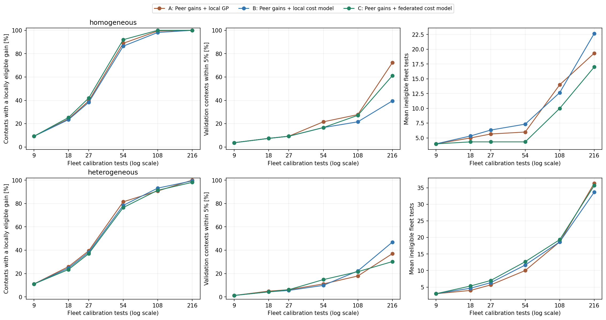

# Cost-model learning with common peer verification

24 November 2026. Results commit:
`fb9e7763b8863d5cdb52c03943650ce2299ac07c`.
Protocol: [tracking_peer_assisted_cost_model.md](../../tracking_peer_assisted_cost_model.md).

The matched comparison gives a clear condition-dependent answer. Federating the
additional cost mean improves homogeneous calibration relative to fitting that
same mean locally, but harms heterogeneous calibration in every tested seed.
Simple peer sharing with a local GP remains a strong comparator. The results
do not establish consistent practical superiority of the federated model over
that simpler method.

## Verification and interpretation of the contrast

All six jobs and **3,888 charged online queries** pass the checkpoint audit.
Each method spends 216 tests per job, each client spends 24, and every arm
finishes in 24 calibration rounds. Every query is numerically resolved.

The audit verifies the common peer priority using only earlier-round eligible
donor incumbents, donor provenance, local verification, target-only incumbents,
context/noise pairing, budget snapshots, peer/model payloads and simulator records.
Arm A reproduces all six frozen one-test gain-sharing traces. Independent
rescoring reproduces the saved 972 client/budget rows, 5,832 context rows,
query/learning tables, primary/secondary paired comparisons, eligibility-time
tables, and transfer logs. No learner starts with historical observations.

The three arms differ in the additional mean used when peer verification is
unavailable:

| Arm | Additional log-cost mean | Shared mechanism |
|---|---|---|
| A | Zero; local GP learns cost directly | Same mandatory peer-gain verification rule |
| B | Fixed-feature model fitted locally | Same mandatory peer-gain verification rule |
| C | Same fixed-feature model fitted through FedAvg | Same mandatory peer-gain verification rule |

The prespecified primary contrast is C minus B in context success at fleet
budget 216. Each method maintains its own online catalogue; different BO
discoveries can alter later peer opportunities. Those downstream effects are
part of the comparison, not free observations from another arm.

Reproduce the audit and derived diagnostics without new physical trials:

```bat
python code/scripts/analyze_tracking_peer_cost.py
```

Input fingerprints and the analysis-source hash are in
[verification.json](verification.json). Optimization sources and completed
result archives are unchanged.

## 1. Homogeneous vehicles: federation improves the local mean, with a tradeoff against A

All methods produce 27/27 complete eligible policies at the final budget.
Costs therefore refer to the same complete set of 27 client trials.

| Method | Contexts within 5% | Mean validation J | Mean failed tests per fleet | Mean local tests until all contexts have an eligible gain |
|---|---:|---:|---:|---:|
| A: Peer gains + local GP | **72.22%** | 0.936566 | 19.33 | 8.30 |
| B: Peer gains + local mean | 39.51% | 1.114733 | 22.67 | 9.48 |
| C: Peer gains + federated mean | 61.11% | **0.836374** | **17.00** | **7.44** |

C improves on B by **21.60 percentage points** in near-reference context success
and reduces mean J by **24.97%**. Its context success and mean J improve in
every homogeneous seed. The shared training data add value beyond the same
mean architecture fitted locally in this condition.

Against A, C reduces mean J by **10.70%**, reduces the average failure count and
establishes eligible policies faster. However, its near-reference context
success is **11.11 points lower**. A reaches the 5% criterion in all six contexts
for 7/27 client policies; B and C do so for none. The aggregate mean-cost gain
does not imply superiority on the declared context-success metric.

C beats A in both context success and mean J for seed 1100, but loses on both
for seeds 1101 and 1102. Thus the mean-J advantage over A is not a consistent
three-seed improvement, even though C versus B is consistently positive.

## 2. Heterogeneous vehicles: the shared mean harms the matched local-model arm

| Method | Contexts within 5% | Complete eligible policies | Mean failed tests per fleet |
|---|---:|---:|---:|
| A: Peer gains + local GP | 37.04% | **27/27** | 36.33 |
| B: Peer gains + local mean | **46.91%** | 26/27 | **33.67** |
| C: Peer gains + federated mean | 30.25% | 24/27 | 35.67 |

C loses **16.67 percentage points** against B and **6.79 points** against A.
On the 24 jointly eligible C/B pairs, mean J is **1.341363 versus 1.028277**:
C is **30.45% higher**. On the 24 jointly eligible C/A pairs, C is **22.04%
higher**. Missing policies remain in the success and completion denominators.
Those paired cost comparisons concern their stated subsets.

B improves context success over A in every heterogeneous seed, while C loses
to B in every seed. Consequently, the negative C/B result cannot be dismissed
as the extra mean architecture being uniformly useless: fitting it locally is
helpful on the primary heterogeneous metric.

The three missing C policies are SUV/nominal, SUV/payload and SUV/front-tire in
seed 1100, all missing an eligible gain for `s30_f0.1`. B has one missing policy,
SUV/front-tire at `s20_f0.1` in that seed. All selected final gains pass the
independent validation eligibility checks; the incomplete policies lack a
locally established eligible gain.

C has lower final context success than B in compact, sport and SUV families:
27.78% versus 48.15%, 33.33% versus 44.44%, and 29.63% versus 48.15%.
The quality loss is not confined to the SUV completion failures.

## 3. The primary contrast by seed

| Condition | Seed | B context success | C context success | C minus B |
|---|---:|---:|---:|---:|
| Homogeneous | 1100 | 40.74% | 74.07% | +33.33 points |
| Homogeneous | 1101 | 33.33% | 48.15% | +14.81 points |
| Homogeneous | 1102 | 44.44% | 61.11% | +16.67 points |
| Heterogeneous | 1100 | 44.44% | 37.04% | -7.41 points |
| Heterogeneous | 1101 | 35.19% | 33.33% | -1.85 points |
| Heterogeneous | 1102 | 61.11% | 20.37% | -40.74 points |

The sign of C minus B is consistent within each condition. Its heterogeneous
magnitude is strongly influenced by seed 1102. These are three programme/noise
realizations on fixed plants, not independent fleet draws or a population-level
significance result.

## 4. Early budgets do not remove the quality/completion distinction

At 54 homogeneous tests, C has complete eligible policies for 14/27 clients,
versus 8/27 for both A and B. At 108 tests C completes all 27, versus 25/27 for A
and 24/27 for B. Its early eligibility establishment is a useful outcome even
though A later has more near-reference contexts.

For heterogeneous vehicles at 54 tests, C has 14.81% near-reference contexts,
versus 9.88% for B and 11.11% for A, but has only 1/27 complete policies versus
6/27 and 7/27. At 108 tests C is at 21.60% context success, versus B's 22.22%.
The early context-success advantage is not maintained at the final budget.

C's heterogeneous mean query count to full eligibility is 12.83 among its
24 successful clients; B's is 11.15 among 26, and A's is 13.59 among all 27.
The corresponding means truncated at the common 24-query cap retain censored
clients; they are recorded with counts in [coverage_timing.csv](coverage_timing.csv).



## 5. Discovery and peer propagation remain active in every method

Across each condition's 621 adaptive decisions per method:

| Condition | Method | BO fallback tests | Eligible BO outcomes | Peer tests | Eligible peer outcomes |
|---|---|---:|---:|---:|---:|
| Homogeneous | A | 239 | 196 | 382 | 379 |
| Homogeneous | B | 239 | 183 | 382 | 382 |
| Homogeneous | C | 255 | 216 | 366 | 366 |
| Heterogeneous | A | 242 | 173 | 379 | 348 |
| Heterogeneous | B | 200 | 148 | 421 | 381 |
| Heterogeneous | C | 243 | 176 | 378 | 347 |

The model has substantial opportunity to influence querying. In the homogeneous
condition, C also has more eligible BO outcomes and a high rate of successful
peer verification. In the heterogeneous condition, B produces more occasions
for peer verification and more recipient incumbent updates than C. Histories
and catalogues diverge after BO choices; the rule remains identical.

Mode-specific costs and success counts are descriptive, not matched causal
effects: the fallback occasions themselves differ. The final recommendation
source table follows donor chains back to their paid factory or BO origin.
The transfer summary counts immediate BO-origin donor records, not all
downstream copies or global novelty of a gain.

## 6. FedAvg convergence is not a sufficient explanation

Replaying federated fitting on exactly C's saved observations reproduces the
logged objective gaps and final model weights. For rounds 1--23, which can
inform later tests:

| Condition | Median objective gap to exact same-data ridge fit | Maximum gap | Median RMS difference in predicted log J | Maximum RMS difference |
|---|---:|---:|---:|---:|
| Homogeneous | 0.000004 | 0.000097 | 0.002001 | 0.009821 |
| Heterogeneous | 0.000009 | 0.000399 | 0.002558 | 0.018668 |

This offers no strong motivation for a training-iteration sweep. It does not
prove the exact pooled fit would produce the same complete adaptive policy:
small fitting differences can change BO decisions and subsequent data. No full
centralized peer-assisted arm was run in this focused comparison.

## 7. A controlled common-history diagnostic does not identify a simple failure cause

The additional offline diagnostic uses only B's saved earlier-round histories
and B's actual fallback occasions. It fits local and federated mean variants
to those same paid observations. Hypothetical outcomes never update a later
history, model or catalogue. A zero-mean proposal is also scored as a reference.

To isolate the mean's effect, this diagnostic holds GP hyperparameters at the
declared initial values for every variant, verifies identical GP variance, and
uses the same eligibility scores, candidate mask and acquisition coefficients.
It is **not a replay of the actual hyperparameter-adapting online policies**.
Proposals are evaluated only retrospectively on the frozen validation bank.

For 239 homogeneous fallback occasions, the federated/local mean variants
propose 184/177 validation-eligible gains and both propose 23 near-reference
gains. Their mean J on 167 jointly eligible proposals is 1.908916/2.430449,
a 21.46% reduction for the federated mean. For 200 heterogeneous occasions,
the counts are 145/135 eligible and 9/10 near-reference; on 121 jointly eligible
proposals mean J is 1.185090/1.648243, a 28.10% reduction.

These one-step outcomes do not reproduce the negative heterogeneous full-run
cost effect. Pooling therefore does not uniformly worsen all individual trial
suggestions in this controlled diagnostic. Trial quality, information gathering,
GP hyperparameter adaptation and catalogue feedback are different quantities.
The diagnostic cannot select a cause for the end-to-end failure or establish
the value of a different full policy. It provides no basis for assuming that
clustering or personalization would automatically solve the problem.

## 8. Communication and consolidated decision

Before the final query, C transmits about 42.2 MB of model payload plus 0.129 MB
of peer payload in the homogeneous case, and 42.4 MB plus 0.118 MB in the
heterogeneous case. A/B peer payloads are about 0.12--0.13 MB. There is no
demonstrated bandwidth advantage under the current 200-server-iteration protocol.

The experiment supports a **homogeneous benefit of federating this mean model
relative to fitting it locally**, including lower mean cost, fewer failures and
faster eligibility establishment. It also supports **heterogeneous deterioration
relative to the matched local mean** at the declared final budget. Strong direct
gain transfer does not, by itself, establish that pooling a cost surrogate is
beneficial for the same fleet.

The stronger practical claim remains unestablished. C does not consistently
beat A across seeds and metrics in the homogeneous condition, and loses to
both A and B on final heterogeneous context success and the paired cost
comparisons. The aggregate 10.70% homogeneous mean-cost improvement over A
cannot be presented as a universal federated calibration advantage.

Freeze the peer rule, initialization and current benchmark. Consolidate the
condition-dependent evidence before further experiments. Any continuation of
the heterogeneous learned-model route should first resolve the surrogate and
sequential decision-design question; a new FL optimizer or an automatic
clustering sweep is not justified by these results. This analysis prepares no
additional physical campaign.
