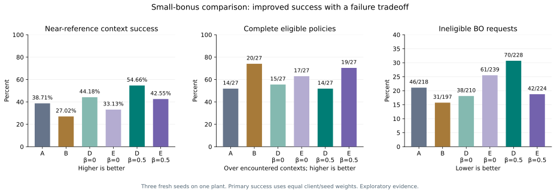
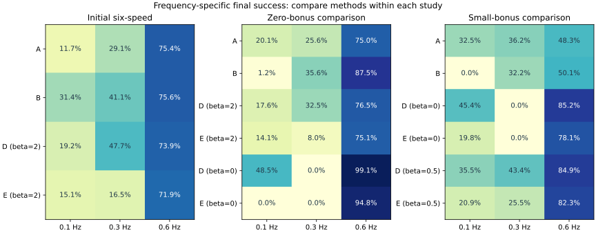

# Six-speed consolidation: cost sharing helps, while exploration changes the tradeoff

25 November 2026. Latest results commit:
`b99a4103fe0012791c17945ebbb8da94fe55f8c2`.
Predeclared [small-bonus protocol](../../tracking_six_speed_small_bonus.md).
The broader research assessment is in [fedbo_consolidation.md](../../fedbo_consolidation.md).

**Small-bonus D meets the practical A/B objective on the declared average
near-reference success metric in all three new seeds.** Its matched D/E
comparison also improves that metric in every seed. It recovers the 0.3 Hz
discoveries missing from zero-bonus D/E.

It does **not** meet the predeclared clean-improvement criterion: it adds
32 failed paid tests and loses one complete eligible policy against D0.
Its paired mean cost is also higher than D0's and slightly higher than A's.
Keep D0 and D0.5 as distinct operating points. The exploration question is now
characterized well enough to consolidate rather than launch another sweep.



## Current matched outcomes

Three fresh seeds, nine homogeneous clients, 24 requests per client and arm.
All six arms retain the same paid exact-context peer-first rule. Success
means within 5% of the held-out cost of the independently calibration-selected
reference; the primary rate averages encountered contexts within each client,
then clients and seeds equally. Missing/ineligible recommendations remain
failures. Complete eligibility concerns every encountered context, not the
full 18-context grid and not necessarily near-reference quality in each one.

| Method | Context success | Complete eligible policies | Failed paid tests | Failed BO tests |
|---|---:|---:|---:|---:|
| A | 38.71% | 14/27 | 55/648 | 46/218 (21.10%) |
| B | 27.02% | 20/27 | 39/648 | 31/197 (15.74%) |
| D, beta = 0 | 44.18% | 15/27 | 46/648 | 38/210 (18.10%) |
| E, beta = 0 | 33.13% | 17/27 | 69/648 | 61/239 (25.52%) |
| **D, beta = 0.5** | **54.66%** | **14/27** | **78/648** | **70/228 (30.70%)** |
| E, beta = 0.5 | 42.55% | 19/27 | 50/648 | 42/224 (18.75%) |

D/E here denote the rank-256 spectral Gaussian models. A is the peer-assisted
local adaptive GP; B fits a local 65-coefficient RFF mean and adaptive residual
GP. E has a local cost model but still participates in the common peer-gain
channel. All methods pay for every requested test, including failures.

| Contrast | Primary success change | Positive seeds | Common complete eligible policies | Paired mean-J change |
|---|---:|---:|---:|---:|
| D0.5 − A | +15.95 pp | 3/3 | 7 | +1.71% |
| D0.5 − B | +27.64 pp | 3/3 | 13 | −27.61% |
| D0.5 − E0.5 | +12.11 pp | 3/3 | 13 | −9.27% |
| D0.5 − D0 | +10.48 pp | 3/3 | 9 | +29.33% |
| E0.5 − E0 | +9.42 pp | 3/3 | 15 | −8.33% |
| D0 − E0 | +11.05 pp | 2/3 | 12 | −27.75% |
| D0 − A | +5.47 pp | 3/3 | 12 | −23.50% |
| D0 − B | +17.16 pp | 3/3 | 13 | −41.52% |

Cost comparisons use only the common complete eligible client policies for
the pair. In particular, the A cost comparison has seven pairs and the D0
comparison nine. They cannot establish unconditional fleet-wide cost
dominance. A higher near-reference rate and a higher mean J can coexist:
the primary metric thresholds relative cost separately in each context,
whereas mean J retains cost magnitudes and uses a complete-policy subset.

## Recovery at 0.3 Hz, with a loss at 0.1 Hz

These frequency rates use equal client/seed weights within each frequency.
Pooled counts are exported separately and use a different weighting.

| Method | 0.1 Hz | 0.3 Hz | 0.6 Hz |
|---|---:|---:|---:|
| A | 32.47% | 36.17% | 48.33% |
| B | 0.00% | 32.16% | 50.06% |
| D0 | 45.43% | 0.00% | 85.25% |
| E0 | 19.75% | 0.00% | 78.09% |
| **D0.5** | **35.49%** | **43.40%** | **84.88%** |
| E0.5 | 20.86% | 25.49% | 82.28% |

D0.5 reaches 51/121 pooled near-reference client/context outcomes at 0.3 Hz,
versus D0's 0/121. Its first near-reference request at that frequency is a BO
test in rounds **8, 8 and 14**, respectively. E0.5's first such discoveries
occur in rounds 16, 15 and 5. D's sharing does not make the first discovery
earlier in every seed, but improves final context success in all three.

Across the current run, D0.5 makes 58 near-reference paid requests at 0.3 Hz:
18 BO requests and 40 peer verifications. D0 and E0 make none. Thus the
benefit includes both discoveries and subsequent use of the gain catalogue.
D/E is a controlled comparison of the added cost-sharing channel's full
online consequence, not an isolation of direct-query selection alone.

The recovered 0.3 Hz success is accompanied by a decline at 0.1 Hz, from
45.43% for D0 to 35.49% for D0.5. The 0.6 Hz rates are almost unchanged.
Neither recovered discovery nor the average gain removes the remaining
quality/eligibility problem.

## Failure and seed dependence remain material

The eight failed factory tests are common to all methods. All 393 D0.5 peer
verifications are eligible, so its remaining 70 failures are BO requests.
Its failure count is higher than D0's and matched E0.5's, rather than merely
having a different denominator in the BO rate.

| Seed | D0.5 − A success | D0.5 − B success | D0.5 − E0.5 success | D0.5 − D0 success | Extra failures versus D0 | Complete eligible D0.5 / D0 |
|---:|---:|---:|---:|---:|---:|---|
| 7100 | +14.17 pp | +21.98 pp | +11.91 pp | +9.94 pp | −6 | 6/9 versus 2/9 |
| 7101 | +10.85 pp | +45.61 pp | +16.22 pp | +7.40 pp | +7 | 7/9 versus 8/9 |
| 7102 | +22.83 pp | +15.33 pp | +8.22 pp | +14.11 pp | +31 | 1/9 versus 5/9 |

Seed 7102 contributes 31 of the 32 net extra failures. D0.5 has only one
complete eligible policy there, versus A's seven. Its average-success
advantage is therefore not a reliable complete-calibration result for each
fleet realization. Against B and matched E0.5, D0.5 loses six and five complete
policies in aggregate, respectively.

The saved `pilot_readout.json` correctly reports six descriptive checks met
and two failed: failed paid requests do increase and complete eligibility
does decline against D0. Both `clean_improvement_over_zero_D` and
`all_descriptive_criteria_met` are false. Those criteria are retained unchanged.

## A specific information gap, not another bonus recommendation

The cost model is trained on eligible log-cost observations. The eligibility
estimator uses the target's own observations, while the peer catalogue
publishes eligible incumbent gains. Failed-test labels do not enter the
federated cost-model likelihood or a shared eligibility model.

A read-only chronological diagnostic finds that **16 of D0.5's 70 failed BO
requests** had an earlier-round failure from a different client at the same
gain and exact speed/frequency context in that same arm. All sixteen also
fail at the recipient; no successful BO request in this study has that
earlier exact peer-failure flag. The diagnostic respects the round barrier:
current-round outcomes are excluded. It never imports another method's data.

This identifies available failure evidence that the current model-sharing
channel does not use. It does not prove sixteen failures could have been
avoided: alternative choices and subsequent histories were not simulated.
The remaining 54 failed BO requests also lack that exact prior-failure
evidence. Hard exclusion, a federated eligibility model and other treatments
of negative evidence are future hypotheses, not established remedies.

## Consolidation across the three six-speed studies

The task, pool, model family and paid peer rule are retained, but programmes
and evaluator noise are fresh between studies. Read paired contrasts within
each study; do not subtract raw rates across studies or pool adaptively chosen
policies into a confirmation claim.

| Study / shared-model policy | D − A success | D − B success | D − matched E success | Positive sharing seeds |
|---|---:|---:|---:|---:|
| Initial six-speed, beta = 2 | +7.96 pp | −2.89 pp | +11.74 pp | 3/3 |
| Zero-bonus study, beta = 2 control | +2.43 pp | +1.32 pp | +10.63 pp | 3/3 |
| Zero-bonus study, beta = 0 | +7.85 pp | +6.75 pp | +16.80 pp | 3/3 |
| Small-bonus study, beta = 0 control | +5.47 pp | +17.16 pp | +11.05 pp | 2/3 |
| Small-bonus study, beta = 0.5 | +15.95 pp | +27.64 pp | +12.11 pp | 3/3 |



All panels use equal client/seed weights within each frequency. Earlier
frequency charts that pooled context outcomes use a different weighting.

The most persistent positive finding is the added sharing contribution to
near-reference success in the tested homogeneous fleet. The persistent
qualification is the quality/eligibility tradeoff. The earlier zero-bonus
0.3 Hz gap repeats in the new three seeds: D0 has no near-reference requests
there in either study. The small positive bonus resolves that particular gap
in the new seeds, with additional failures.

Clients encounter roughly 13.6–13.9 of the 18 speed/frequency contexts and
5.89–5.93 of the six speeds. These studies mainly impose sparse exploration
of gain/context pairs, not sustained absence of whole speed ranges. All
clients use the same speed distribution. Claims of route-specific non-IID
coverage or extrapolation to unvisited operating ranges are not established.

## Metric sensitivity and communication scope

A post-hoc sensitivity check scores the same final recommendations at other
relative-cost thresholds. It does not change the declared 5% primary target.

| Threshold | A | B | D0 | D0.5 | E0.5 |
|---:|---:|---:|---:|---:|---:|
| 2.5% | 30.43% | 22.18% | 35.43% | 44.28% | 32.97% |
| **5% — primary** | **38.71%** | **27.02%** | **44.18%** | **54.66%** | **42.55%** |
| 10% | 48.62% | 37.93% | 50.24% | 65.84% | 50.15% |
| 20% | 62.62% | 49.62% | 54.64% | 69.82% | 57.99% |

The D0.5 hit-rate advantage is present at these other thresholds too. This
does not remove its failed-test, complete-policy or paired mean-cost tradeoffs.

The final-decision reference model payload averages **659.69 MB per shared
arm/fleet**, plus about 0.20 MB of peer messages. Counts include packed
float64 precision/covariance triangles, vectors, evidence scalars and
per-recipient broadcasts through the information used at the last decision;
unused end-of-final-round training is excluded. Initial public-basis
distribution and transport overhead are separate. These are logical payload
estimates, not measured network latency or a communication improvement.

## Audit closure and next decision

The read-only consolidation verifies **10,368 paid decisions**, nine jobs and
**36 numerical tables** across all three studies. It also reconstructs the
small-bonus criteria and consolidation summary. All source-result files retain
their hashes. No new controller rollout or hyperparameter optimization is run.
The original bounds repair's paid prefixes remain verified. A/B audits restore
logged fitted states; identical fresh cross-platform optimization is not claimed.

Each study has 2,556 dense calibration rollouts and 72 evaluator batches.
The original, zero-bonus and small-bonus validation counts are 1,066, 1,230 and
1,136, respectively. All references are available and no online integration
attempt is unresolved. The pinned basis and its slight diagonal-target miss
are retained. The [verification record](verification.json) includes source
commits, signatures, raw-input fingerprints and every table check.

Reproduce without modifying source results:

```bat
python code/scripts/consolidate_tracking_six_speed.py --workers 3
```

The next step is the broader decision in [the main consolidation](../../fedbo_consolidation.md).
Keep the current exploration ablation closed. The evidence supports a limited
online cost-sharing claim; reliable eligibility, heterogeneous added value
and communication efficiency remain distinct research questions. No new
policy variant, simulation campaign or communication protocol is implemented
by this analysis.
