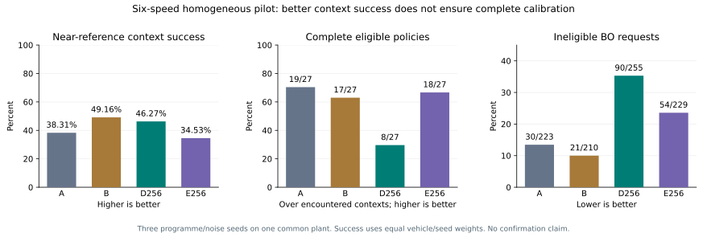

# Six-speed pilot: shared cost information helps success, but eligibility limits D256

25 November 2026. Results commit:
`d9a68cfe2f129733d3e4a63719fe2f05d5156742`.
Predeclared [pilot protocol](../../tracking_six_speed.md).

## Decision

**D256 does not yet meet the practical objective of beating A and then B.**
Its final near-reference context success is higher than A and the matched
local spectral control E256 in all three seeds. However, D256 provides a
complete eligible policy over encountered contexts for only 8 of 27 vehicle
runs, compared with 19 for A, 17 for B and 18 for E256. B has the highest
context success. The quality/eligibility tradeoff must remain explicit.

The D256/E256 contrast supports an added sharing contribution to the success
metric in this pilot, but not an unqualified controller-calibration benefit.
Three programme/noise seeds on one common plant are exploratory evidence,
not a confirmation campaign or evidence on heterogeneous vehicles.



## Protocol and audit closure

Nine homogeneous compact vehicles start without cost history and receive
24 charged requests each. The speed is sampled with replacement from
20/22/24/26/28/30 m/s; the three frequencies remain balanced in shuffled blocks. Every
method uses the same prior-round, exact-context peer-first verification rule.
All methods pay for all requested tests, including failures.

The read-only audit validates all three jobs and **2,592 paid decisions**.
A/B predictions and choices are reproduced from logged pre-query GP fit
states, with optimization disabled; D/E predictions and choices are
reconstructed from their own earlier histories. Explicit guards prohibit new
optimization or rollout calls during this replay. All **11 saved numerical
tables** recompute from the paid histories and **72 evaluator batches**.
There are 2,556 dense calibration rollouts and 1,066 held-out validation
rollouts. All 18 references are available. No online integration request is
unresolved. No source result, action, threshold or budget is changed.

The bounds repair is also verified. Seeds 5100/5102 were complete and their
entire original result bodies remain unchanged. Seed 5101's first six rounds,
54 requests per method, retain identical events, histories, learning logs,
snapshots and simulator records. The only recovery is A's refit at seed 5101,
round 7, client 08, before testing g002 at 20 m/s and 0.3 Hz. No completed
controller test is replaced. Windows backup-byte hashes match exactly after
restoring CRLF line endings normalized to LF by Git; payload checks are
separate from that transport normalization.

The [verification record](verification.json) contains source/input fingerprints,
table checks and the precise replay scope. Fresh cross-platform GP refitting
is not claimed.

## Final outcomes at 24 tests per vehicle

The primary success rate first averages over each vehicle's encountered
contexts, then over vehicles and programme seeds. It differs slightly from
the pooled successful-context count divided by 376. Missing recommendations
and validation-ineligible recommendations in encountered contexts remain
failures. Complete-policy eligibility refers to all encountered contexts,
not the full 18-context grid.

| Method | Primary context success | Successful contexts, pooled | Complete eligible policies | Conditional mean J |
|---|---:|---:|---:|---:|
| A | 38.31% | 143 / 376 | 19 / 27 | 1.4039 |
| B | 49.16% | 185 / 376 | 17 / 27 | 1.1804 |
| D256 | 46.27% | 173 / 376 | 8 / 27 | 1.2777 |
| E256 | 34.53% | 130 / 376 | 18 / 27 | 1.3735 |

Per-method mean J conditions on that method's complete eligible policies;
those denominators differ. Paired costs below use only policies eligible
for both compared methods.

| Contrast | Primary success change | Positive seeds | Complete policies D/comparator | Common eligible pairs | Paired mean-J change |
|---|---:|---:|---:|---:|---:|
| D256 − A | +7.96 pp | 3 / 3 | 8 / 19 | 6 | −7.25% |
| D256 − B | −2.89 pp | 1 / 3 | 8 / 17 | 6 | +9.03% |
| D256 − E256 | +11.74 pp | 3 / 3 | 8 / 18 | 6 | −10.45% |

The six-pair cost gains against A/E cannot establish fleet-wide superiority
after most complete policies are lost. Against A, six policies are eligible
for both, two only for D256, thirteen only for A, and six for neither.
Against E256, the corresponding counts are six/two/twelve/seven.

| Seed | D256 − A success | D256 − B success | D256 − E256 success |
|---:|---:|---:|---:|
| 5100 | +3.69 pp | +6.47 pp | +6.49 pp |
| 5101 | +8.92 pp | −7.43 pp | +15.01 pp |
| 5102 | +11.26 pp | −7.70 pp | +13.71 pp |

No confidence interval or confirmation flag is assigned to these three seeds.
Vehicles and contexts within a fleet programme are not independent replicates.

## What the expanded operating programme actually tests

Vehicles encounter a mean of **13.93 of 18 contexts**, ranging from 12 to 17.
Their mean speed coverage is **5.89 of six speeds**: only three of 162 possible
vehicle/speed pairs are unvisited. Thus most incomplete local coverage is in
speed/frequency pairs and gain exploration, not whole missing speed ranges.
All clients use the same speed distribution; this is not a route-specific
non-IID exposure experiment.

Of the 376 encountered vehicle/context pairs, 188 are visited once, 119 twice,
57 three times, nine four times and three five times. **Half of encountered
contexts have only one local test.** No vehicle covers the full grid; those
unvisited entries are reported separately and are not declared calibrated.

The saved context programmes make all these denominators identical between
methods. Budget curves change their encountered-context denominator over time;
they are not directly comparable to the earlier fixed six-context rates.

## First and later encounters

These rates average each seed's relevant visit-group rate equally. The first
two rows evaluate the requested controller, requiring eligibility both in
the paid online test and in held-out validation. The last row evaluates the
locally verified incumbent after a repeated-context visit; exploration can
retain a previous incumbent.

| Outcome | Requests per method | A | B | D256 | E256 |
|---|---:|---:|---:|---:|---:|
| First speed/frequency visit, excluding factory | 349 | 29.29% | 37.87% | 34.75% | 27.31% |
| First speed visit, excluding factory | 132 | 23.58% | 24.30% | 22.79% | 17.59% |
| Incumbent after a repeated-context visit | 272 | 42.14% | 53.31% | 48.11% | 37.48% |

D256/E256 improves these success readouts, but D256 does not beat A or B on
the first-ever local visit to a speed. This limits the proposed claim of
superior first-encounter speed adaptation.

These comparisons do not isolate interpolation alone. For D256, 271 of 349
first-context requests after factory, and 95 of 132 first-speed requests,
verify an exact-context peer incumbent. The larger grid retains substantial
peer availability. D/E's later catalogues can diverge because of their earlier
discoveries, so their contrast measures the full online consequence of adding
cost sharing, not a direct-query-only intervention.

## The eligibility loss is concentrated in BO choices

| Method | Ineligible BO requests | Ineligible BO rate | Ineligible peer verifications |
|---|---:|---:|---:|
| A | 30 / 223 | 13.45% | 0 / 398 |
| B | 21 / 210 | 10.00% | 1 / 411 |
| D256 | 90 / 255 | 35.29% | 0 / 366 |
| E256 | 54 / 229 | 23.58% | 0 / 392 |

All methods additionally have the same 12 ineligible factory tests out of
27. D256's total ineligible paid count is 102/648 versus A's 42/648 and B's
34/648. Of D256's 102 failures, 54 terminate at the numerical/state guard,
44 violate lateral error, and four violate lateral error and sideslip.
These are retained charged failures, not discarded or unresolved integration
episodes. The model's eligible log-cost labels exclude them; its local
eligibility estimate still receives the failures.

D256 ends with 25 encountered contexts lacking a locally eligible gain,
spread across 19 vehicle runs. It has no selected gain failing held-out
eligibility. A has nine missing local contexts. B has eight missing local
contexts plus two validation-ineligible recommendations. E256 has twelve
missing local contexts.

Twelve of D256's missing contexts are at **28 m/s, 0.1 Hz**. At that context,
D256 has zero near-reference successes and only 11 eligible recommendations
among 23 encounters. A/B/E256 retain 22/21/22 eligible recommendations. This
is a material failure concentration, rather than only a loss induced by
evaluating more contexts.

## Existing-history check of the uncertainty bonus

At the 255 actual D256 BO information states, the read-only diagnostic
reconstructs its full allowed-candidate predictions. It verifies the original
choice and then removes only the `−2σ` acquisition bonus, keeping the same
posterior mean, eligibility penalty, untested-candidate restriction and tie
rule. Existing dense **calibration** labels score the alternatives after
ranking; no label enters their selection.

The zero-bonus ranking changes 240 of 255 choices. Its selected alternatives
are eligible in both calibration repeats at **215/255** states, versus
**165/255** for the actual selections. At **57 of the 90** actual ineligible
online queries, the zero-bonus alternative is calibration-eligible.
Across the calibration comparison it gains 57 eligible selections, loses
seven previously eligible selections, retains 158, and leaves 33 ineligible.

This supports investigating the exploration/eligibility tradeoff. It is
**not an online performance result**: histories, observations and peer
catalogues are held at the actual D256 values; a different policy would
change them. Alternative gains have not all received a new held-out campaign,
and this diagnostic does not establish that zero bonus is the best setting.
It cannot replace a matched fresh online test.

The logged score terms point in the same direction. D256's failed BO requests
have mean latent standard deviation 0.974 and mean predicted eligibility
0.556, corresponding to an uncertainty bonus near 1.95 log-cost units.
A/B failed-query standard deviations are 0.703/0.488. These different selected
subsets are descriptive evidence, not a randomized explanation of why one
method fails more often. D/E also retain fixed covariance settings while
A/B adapt their GP hyperparameters.

## What to retain and what to test next

1. Retain the positive but qualified sharing signal: D256/E256 improves
   near-reference success in all three seeds, while losing complete policies.
2. Retain B as the strongest observed success reference, with A still providing
   the largest complete-policy count. Do not equate D256's success advantage
   over A with meeting the full practical objective.
3. Keep the six-speed task and shared/local formulation fixed for the next
   decision. A focused, matched D/E test of a smaller uncertainty bonus,
   including the zero-bonus diagnostic endpoint, is better motivated than
   another increase in speeds, physical heterogeneity or communication changes.
   Use fresh online programmes and retain A/B as practical comparators.

This is a recommendation, not a prepared new experiment. The present analysis
adds no controller simulation or hyperparameter search. It does not alter
the previously established homogeneous six-context sharing benefit or the
unconfirmed heterogeneous sharing benefit.

The six-speed rank-256 representation's 0.521% kernel error and 5.112%
maximum diagonal error remain documented. The latter narrowly exceeds the
earlier 5% target. Its effect is not isolated by this pilot; the matched D/E
comparison uses the same approximation. D256 learns expected sharing fraction
effectively one before the final query in all three seeds; that alone does
not guarantee useful controller calibration.

## Reproduction

From the repository root:

```bat
python code/scripts/analyze_tracking_six_speed.py --workers 3
python code/scripts/plot_tracking_six_speed_analysis.py
```

These commands write only this analysis directory. The original campaign
results remain unchanged. Exact counts, per-seed effects, visit groups,
failure records, fixed-history alternative rankings and audit fingerprints
are saved alongside this report.
