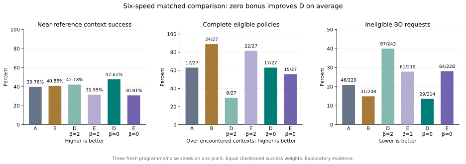
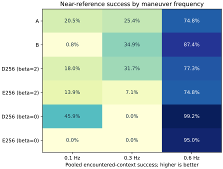

# Six-speed zero-bonus comparison: improved average performance, with a discovery gap

25 November 2026. Results commit
`a856d250fdd62f6430fefc937cb08df344bcbc76`.
The [predeclared protocol](../../tracking_six_speed_zero_bonus.md) fixes the
task, models, eligibility penalty and paid peer-first rule. D256/E256 with
beta = 0 are compared with A/B and beta = 2 D256/E256 on the same fresh
programmes and noise. Here D0/E0 denote the **spectral rank-256 zero-bonus
arms**, not the older random-feature controls.

**D0 has the best average success on the declared metric.** It improves over A
by 7.85 percentage points, B by 6.75 points and its matched local control E0
by 16.80 points. Removing the bonus also substantially reduces D's failed BO
requests. This is evidence for a useful contribution from online cost-model
sharing beyond the common peer-gain channel.

The conclusion remains condition dependent. D0 loses to A in one of three
seeds, provides fewer complete eligible policies than B, and finds no
near-reference controller at 0.3 Hz. The present result supports retaining D0
as the strongest average-performance reference. It does not support the
broader claim that explicit cost exploration is unnecessary.



## Audit and experimental scope

The read-only audit reproduces **all 3,888 paid decisions** in three jobs and
reconstructs **all 11 saved numerical tables**. A/B use their logged pre-query
GP fits; D/E predictions and choices are rebuilt from their own earlier paid
histories. Guards prohibit both optimizer and simulator calls during replay.
Fresh cross-platform optimizer identity is not claimed.

There are 72 evaluator batches: 2,556 dense calibration rollouts and 1,230
independent validation rollouts. The validation union includes the reference
winner and every gain paid for by any method/seed in each context. All 18
references are available, no integration request is unresolved, and no GP
bounds recovery was needed. All 93 source-result files retain their hashes.
The audit performs no new controller rollout or hyperparameter optimization.

Each of nine clients on one common compact plant receives 24 requests per
method, including the factory test and all failed attempts. Speeds are drawn
with replacement from six values, and the three frequencies use balanced
shuffled blocks. Histories and peer catalogues are separate across methods.
Every round's actions precede its observations and communication.

Clients encounter a mean of 13.59/18 speed/frequency contexts (range 10–16),
and 5.89/6 speeds. The **367 encountered client/context pairs per method**
comprise 164 single visits, 141 double visits, 49 triple visits, eleven
quadruple visits, one quintuple visit and one six-visit context. Unvisited
contexts are separate from failures in encountered contexts. No run covers
the full context grid. Three programme/noise seeds on one physical plant are
exploratory replication, not independent heterogeneous-fleet confirmation.

The [verification record](verification.json) includes input fingerprints,
source signature, table checks and replay scope. Reproduce with:

```bat
python code/scripts/analyze_tracking_six_speed_zero_bonus.py --workers 3
```

## Final outcome at 24 requests per client

Primary success averages the near-reference success rate across encountered
contexts within each client, then across clients and seeds equally. A
missing or validation-ineligible incumbent remains a failure. Complete-policy
eligibility requires an eligible recommendation in every encountered context;
it does not require every recommendation to meet the near-reference target.

| Method | Primary context success | Pooled successful contexts | Complete eligible policies | Ineligible BO tests |
|---|---:|---:|---:|---:|
| A | 39.76% | 146/367 | 17/27 | 46/220 (20.91%) |
| B | 40.86% | 149/367 | 24/27 | 31/208 (14.90%) |
| D256, beta = 2 | 42.18% | 154/367 | 8/27 | 97/243 (39.92%) |
| E256, beta = 2 | 31.55% | 115/367 | 22/27 | 61/219 (27.85%) |
| **D256, beta = 0** | **47.61%** | **174/367** | **17/27** | **29/214 (13.55%)** |
| E256, beta = 0 | 30.81% | 113/367 | 15/27 | 64/228 (28.07%) |

Each method also has the same seven failed factory tests among 27. D0 has
36 total ineligible paid requests out of 648, compared with A's 53, B's 38,
D2's 105, E2's 70 and E0's 77. D0's 407 peer verifications are all online
eligible. The lower failed-BO rate therefore accompanies a lower total
failure count; it is not only a change in the BO/peer denominator.

| Matched contrast | Primary success change | Positive seeds | Common complete eligible policies | Paired mean-J change |
|---|---:|---:|---:|---:|
| D0 − A | +7.85 pp | 2/3 | 12 | −23.66% |
| D0 − B | +6.75 pp | 3/3 | 16 | −25.14% |
| D0 − E0 | +16.80 pp | 3/3 | 10 | −29.66% |
| D0 − D2 | +5.43 pp | 2/3 | 5 | −19.03% |
| E0 − E2 | −0.74 pp | 1/3 | 14 | +10.57% |

Cost differences condition on complete eligible policies for both methods.
They are not unconditional cost reductions over all 27 runs. In particular,
the D0/D2 cost contrast has only five eligible pairs. No confidence interval,
statistical significance or confirmation flag is assigned to three seeds.

| Seed | D0 − A | D0 − B | D0 − E0 | D0 − D2 |
|---:|---:|---:|---:|---:|
| 6100 | +8.86 pp | +11.97 pp | +23.19 pp | +15.06 pp |
| 6101 | +19.14 pp | +2.51 pp | +19.63 pp | +4.64 pp |
| 6102 | −4.45 pp | +5.76 pp | +7.56 pp | −3.43 pp |

The primary objective of exceeding A and then B is met **on the aggregate
success metric in this pilot**, with a consistent D0/B sign. It is not met
uniformly across seeds or on complete-policy eligibility against B.

## What removing the bonus changes

In the shared model, moving from beta = 2 to 0 increases primary success
from 42.18% to 47.61%, increases complete eligible policies from 8 to 17 and
reduces failed BO tests from 97 to 29. In the local model the same change
slightly reduces success, lowers complete eligibility from 22 to 15, and
does not reduce BO failures. Thus zero bonus is not a general improvement
for this model family independent of sharing.

The beta = 0 score still includes the predicted log cost and the negative-log
local eligibility penalty. Full posterior covariance and evidence-based
sharing inference remain active. The shared model favors the fully shared
component at the end of all three seeds, as expected for this homogeneous
fleet. This is an observation about the tested homogeneous condition, not
evidence that personalization is unnecessary for heterogeneous vehicles.

The D0/E0 comparison measures the full online consequence of sharing cost
information. Their peer rules are matched, but earlier cost-model proposals
change later catalogues and peer opportunities. The observed advantage can
therefore include both better direct BO choices and improved downstream
gain transfer. It does not isolate a direct-query-only effect.

## The remaining discovery gap is specific and material

The frequency breakdown reveals a tradeoff hidden by the overall mean. These
rates pool encountered client/context outcomes within each frequency, rather
than using the primary equal-client weighting.

| Method | 0.1 Hz success (122 contexts) | 0.3 Hz success (126 contexts) | 0.6 Hz success (119 contexts) |
|---|---:|---:|---:|
| A | 20.49% | 25.40% | 74.79% |
| B | 0.82% | 34.92% | 87.39% |
| D256, beta = 2 | 18.03% | 31.75% | 77.31% |
| E256, beta = 2 | 13.93% | 7.14% | 74.79% |
| **D256, beta = 0** | **45.90%** | **0.00%** | **99.16%** |
| E256, beta = 0 | 0.00% | 0.00% | 94.96% |



D0 provides locally and validation-eligible final gains in **all 126**
encountered 0.3 Hz contexts, but none meets the 5% cost target. Their median
relative gap is **27.83%**, with a minimum of 6.10%; this is not merely a
small threshold-crossing effect. D0 makes 216 paid requests at that frequency:
six factory tests, 63 BO tests and 147 peer tests. None of those requested
controllers meets the held-out near-reference target. E0 also records zero
near-reference requests there.

By contrast, D2 makes 45 near-reference requests at 0.3 Hz. Its first such
discovery in each seed is a BO request, occurring at rounds 10, 8 and 2,
respectively. The conservative statement is that zero bonus is associated
with a persistent discovery gap in these runs, while the bonus-2 policy
discovers useful gains there. A/B also find useful gains in all three seeds.
The traces do not establish that beta = 2 is the best exploration rule, nor
that a small positive bonus would resolve the gap online.

At 0.1 Hz, D0's shared information raises success from E0's 0/122 to 56/122.
At 0.6 Hz, both zero-bonus methods perform well. This is the clearest
condition-dependent reading of the sharing benefit. A plausible explanation
is that shared observations support more effective exploitation in parts of
the domain, while correlated greedy choices fail to discover other regions.
This explanation is an inference from the trajectories, not a separate
controlled test of the mechanism.

Seed 6102's D0/A loss is likewise not a uniform deficit across speeds. On
the pooled context count D0 wins six client/context outcomes and loses twelve
against A. Four losses are at 24 m/s, 0.1 Hz, and four at 30 m/s, 0.3 Hz;
four wins occur at 30 m/s, 0.1 Hz. The equal-client primary effect is
−4.45 points. The full context contrasts are exported for all comparisons,
not only for this unfavorable seed.

## First encounters and eligibility

These visit-group rates average the relevant rate equally over seeds.
First-visit rows evaluate the paid requested controller; the repeated-visit
row evaluates the incumbent retained after the visit.

| Outcome | Requests per method | A | B | D2 | E2 | D0 | E0 |
|---|---:|---:|---:|---:|---:|---:|---:|
| First speed/frequency context, after factory | 340 | 26.07% | 27.70% | 30.04% | 22.37% | 35.36% | 25.04% |
| First speed, after factory | 132 | 13.57% | 16.74% | 17.48% | 12.11% | 27.33% | 16.72% |
| Incumbent after repeated context | 281 | 43.63% | 45.38% | 43.35% | 32.72% | 55.08% | 33.83% |

These outcomes support practical value from D0 in this pilot, including first
local speed encounters. They do not isolate interpolation: 278 of D0's 340
first-context requests and 87 of 132 first-speed requests use an exact-context
peer gain. The gain catalogue itself can reflect earlier model-guided
discoveries elsewhere in the fleet.

D0's 17 complete eligible policies equal A's count but refer to different
runs: twelve are complete for both, five only for D0, five only for A and
five for neither. Against B, sixteen are complete for both, one only for D0,
eight only for B and two for neither. Thus the complete-policy gap to B
remains practically relevant.

D0 has twelve encountered contexts lacking a locally eligible gain, all at
0.1 Hz; no selected D0 gain fails held-out eligibility. Four missing contexts
are at 26 m/s, four at 30 m/s, three at 28 m/s and one at 24 m/s. D2 has
22 missing local gains plus four held-out-ineligible selected gains. B has
only three missing gains and no held-out-ineligible selections. Cost quality
at 0.3 Hz and eligibility at 0.1 Hz are distinct remaining limitations.

## Decision before the next experiment

Retain **D256 with beta = 0** as the main average-performance reference,
alongside A, B and its matched E0 control. Keep the original beta = 2
comparison frozen as the exploration ablation. The evidence now supports
an online sharing benefit with a substantially improved eligibility tradeoff;
it does not support universal dominance or eliminating exploration.

Before a communication study or a new kernel/plant variant, focus the next
method decision on the identified **discovery versus failure** tradeoff:
preserve D0's useful exploitation while allowing useful discoveries at
0.3 Hz. A restrained positive bonus or a small explicit discovery allocation
are candidates, not validated solutions. A single focused comparison should
retain A/B benchmarks, a matched local control, the existing 5% target and
eligibility readouts, and fresh programme seeds. The aim is to resolve the
specific limitation above, not expand model complexity or retune the task to
favor sharing. This report prepares that decision; no new online experiment
is launched or implementation variant added here.

The public basis is unchanged, including its slight maximum-diagonal target
miss. Message accounting is also unchanged. These results make no
communication-efficiency claim and do not establish heterogeneous-fleet
performance.
