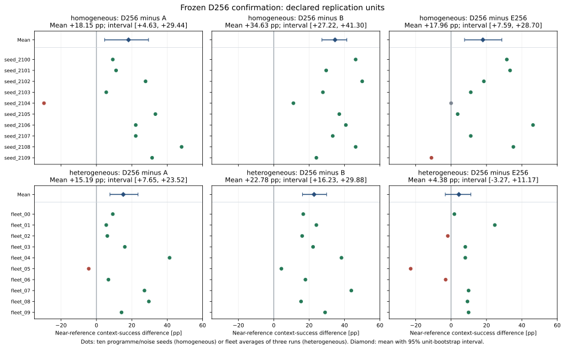

# D256 confirmation: primary gains over A, condition-dependent value of sharing

24 November 2026. Results commit:
`ef7192086b4318e93cf2f960490f39a34032a4fa`.
Fixed protocol: [tracking_confirmation.md](../../tracking_confirmation.md).
Development result: [spectral online campaign](../spectral_online_cost_model/report.md).

25 November follow-up: the [GP replay closure](../gp_replay_closure/report.md)
validates A's original-environment trace and recovers all 594 affected BO
decisions from logged GP states on Linux. Fresh cross-platform refitting
remains non-identical; no confirmation score or criterion is changed.

## Decision under the declared criteria

**The committed confirmation results meet the primary D256/A criteria in both
conditions.** D256 improves near-reference context success, lowers cost on common
eligible policies, and preserves the aggregate complete-policy eligibility
count relative to A. Nine of ten replication units improve in each condition.

The broader objective has a qualification. Homogeneous D256/B and D256/E256
also meet the criteria. Heterogeneous D256/B improves success and paired cost
but loses complete policies, so it does not pass the combined criterion.
Heterogeneous D256/E256 does not confirm an added benefit from cost sharing:
its success interval includes zero, paired mean cost is higher, and eligibility
is lower. Retain E256 as a strong heterogeneous reference.

The original-run validity concern raised by A's eight Linux replay differences
is now resolved by the original-environment and logged-state follow-up.
The remaining qualification concerns identical fresh hyperparameter refits
across numerical environments, rather than the validity of the saved choices.

## Audit scope and numerical reproduction

The audit validates all 40 jobs, their fixed physical draws, source/configuration
signatures, public basis, factory tests, context programmes, noise pairing,
peer priority, earlier-round barriers, own-arm histories, simulator records,
local caps and communication accounting. All **13 saved numerical tables**
recompute from the recorded histories and **2,184 evaluator batches**. No source
result is rewritten, no controller is newly simulated, and no new policy
campaign is run.

There are 34,560 charged online requests, 77,532 fresh offline calibration
rollouts and 12,490 held-out validation rollouts. All 546 physical plant/context
references are available and independently eligible. Sixteen unresolved online
attempts are retained as charged, ineligible tests. No fleet, seed or failed
attempt is dropped. One selected final B controller fails held-out validation;
that outcome remains ineligible.

The initial Linux audit separately replayed each arm so a baseline difference
could not hide a check on another method. These historical fresh-refit counts
are retained:

| Method | Exact decision-path replays on Linux | Total jobs |
|---|---:|---:|
| A | 32 | 40 |
| B | 40 | 40 |
| D256 | 40 | 40 |
| E256 | 40 | 40 |

The committed original-runtime verification reports all four policies replayed
successfully. The initial independent audit also tested the recorded Python
3.11.16, NumPy 2.3.2, SciPy 1.16.1 and pandas 2.3.1 versions on Linux. Matching
those versions did not remove the eight A differences. Public input coordinates
match exactly, and all non-action protocol fields match at the first difference.
The first discrepancies occur in A's adaptive local-GP acquisition choices
for seeds 2103/2106/4104/4111/4112/4117/4123/4129.

These are not simply choices inside the declared 1e-12 acquisition tie band:
the recorded-minus-computed first-choice score gaps range from about .000067
to .223 under the Linux-refitted states. The [first-difference table](first_replay_differences.csv)
preserves those cases. The follow-up now locates the difference in GP refitting:
all 594 original Windows BO choices match the recorded campaign, their prior
history fingerprints and refit counters match the Linux trace, and reusing
the original fitted states on Linux recovers all 594 choices. The maximum
acquisition-score difference under those fixed states is 1.51e-14.

The Linux fixed-path diagnostic has 15 differing choices across those eight
jobs. Restoring its own logged fit states also recovers all 594 Linux diagnostic
choices. These checks isolate fitted-state variation from prediction and
acquisition. The particular OS/compiler/math-library contribution has not been
separated; no specific library defect is claimed.

The primary claims below describe the committed common execution environment
and recorded policies. Their scores, intervals and original A choices are
verified. Fresh refitting remains numerically platform dependent. The D256/B
and D256/E256 decision replays are complete for every job. The historical
[verification record](verification.json) retains its all-four fresh-replay flag
false; the separate [closure verification](../gp_replay_closure/verification.json)
records successful logged-state recovery. No actions, outcomes or tie thresholds
are changed to obtain that recovery.

## Final outcomes at the 24-test local cap

Each homogeneous method has 90 client runs and 540 context outcomes across ten
fresh programme/noise seeds on the declared common compact plant. Each
heterogeneous method has 270 client runs and 1,620 context outcomes across ten
independent physical fleets, each with three fresh runs. Heterogeneous analysis
units are the ten fleet averages, not the 30 runs, 90 plants or 1,620 contexts.

Context success means within 5% of the finite-pool empirical reference under
held-out noise. Asterisks mark conditional mean costs over eligible policies;
the paired cost contrasts below use their own common eligible denominators.

| Condition | Method | Successful contexts | Context success | Eligible policies | Mean J |
|---|---|---:|---:|---:|---:|
| Homogeneous | A | 311 / 540 | 57.59% | 90 / 90 | 1.0563 |
| Homogeneous | B | 222 / 540 | 41.11% | 90 / 90 | 1.0061 |
| Homogeneous | D256 | 409 / 540 | 75.74% | 90 / 90 | .8553 |
| Homogeneous | E256 | 312 / 540 | 57.78% | 90 / 90 | .8955 |
| Heterogeneous | A | 796 / 1,620 | 49.14% | 258 / 270 | 1.1739* |
| Heterogeneous | B | 673 / 1,620 | 41.54% | 265 / 270 | 1.0689* |
| Heterogeneous | D256 | 1,042 / 1,620 | 64.32% | 261 / 270 | .9109* |
| Heterogeneous | E256 | 971 / 1,620 | 59.94% | 270 / 270 | .8741 |

Fresh calibration and validation banks were generated for this campaign. Do
not pool these outcomes with the development seeds or interpret changes in
absolute rates between campaigns as paired gains or losses.

## Practical comparators: A first, then B

Intervals are the predeclared 95% percentile bootstrap intervals over ten
replication units. Positive success changes favor D256; negative J changes
favor D256. Each criterion also requires full reference coverage, a positive
success lower bound and no reduction in complete-policy eligibility.

| Condition | Contrast | Success change | Unit-bootstrap interval | Paired mean-J change | Common eligible pairs | Criterion |
|---|---|---:|---|---:|---:|---|
| Homogeneous | D256 minus A | +18.15 pp | [+4.63, +29.44] pp | -19.03% | 90 | Pass |
| Heterogeneous | D256 minus A | +15.19 pp | [+7.65, +23.52] pp | -23.23% | 250 | Pass |
| Homogeneous | D256 minus B | +34.63 pp | [+27.22, +41.30] pp | -14.99% | 90 | Pass |
| Heterogeneous | D256 minus B | +22.78 pp | [+16.23, +29.88] pp | -14.72% | 257 | Fails eligibility condition |

The A primary outcome is more consistent than the three-seed development
result: success improves in nine of ten homogeneous seeds and nine of ten
heterogeneous fleet averages. Heterogeneous raw-run signs are 23 positive,
one tied and six negative. The worst fleet-average success difference is
-4.32 pp; the worst homogeneous seed is -29.63 pp. There is no per-seed or
per-client dominance claim.

Heterogeneous D256/A success improves in all three families in aggregate:
13.33 pp compact, 15.56 pp sport and 16.67 pp SUV. Against B, each family also
has higher aggregate context success, but compact and SUV lose complete
policies. The combined B criterion therefore remains false despite positive
success differences in all ten fleet averages.

## What federated cost learning adds beyond the common peer channel

D256/E256 is the matched comparison: both use the same public basis, marginal
cost prior, observation noise, decision formulas and paid peer-first rule.
Only D256 introduces cost-model dependence across vehicles. Their later
histories and own catalogues can diverge as a consequence.

| Condition | D256 minus E256 success | Unit-bootstrap interval | Paired mean-J change | Eligible policies D/E | Criterion |
|---|---:|---|---:|---|---|
| Homogeneous | +17.96 pp | [+7.59, +28.70] pp | -4.49% | 90 / 90 | Pass |
| Heterogeneous | +4.38 pp | [-3.27, +11.17] pp | +5.21% | 261 / 270 | Fails |

This supplies positive evidence for additional cost sharing in the homogeneous
condition on the tested plant and programme/noise distribution. Its context
success improves in eight seeds, ties in one and loses in one. Cost improves
in seven of ten seeds, so the aggregate mean-cost benefit still permits
individual reversals.

The heterogeneous result does not establish additional value from cost sharing.
Seven fleet averages improve context success and three deteriorate; only four
have lower paired cost. E256 has an eligible complete policy for every client
run. D256 has 71 more near-reference contexts overall but nine fewer complete
policies. On the 261 common eligible policies D256's mean J is .9109 versus
E256's .8659, giving the 5.21% cost increase. Comparing it with E256's mean over
all 270 would use a different denominator.

The context-specific reference thresholds and pooled raw J weight outcomes
differently. A higher near-reference rate with a worse mean cost is a genuine
metric tradeoff. It must not be collapsed into a universal D/E win or loss.
Likewise, D256/A changes representation and statistical modeling as well as
sharing. The practical A advantage does not by itself isolate a benefit from
federating the cost model; E256 is already a strong heterogeneous method while
retaining the common peer-gain channel.

Before the final query, D256's expected sharing fraction is effectively one
for every homogeneous run. Heterogeneous runs have a median around .750,
with a range about .500--.950. Learned nonzero sharing does not ensure that
its incremental controller-search value is positive.



## Eligibility failures and remaining low-frequency sensitivity

D256's nine incomplete heterogeneous policies are all missing a locally
eligible gain, rather than holding a selected gain that fails validation.
Eight missing contexts are at 30 m/s, .1 Hz and one at 20 m/s, .1 Hz. They
occur in five fleets and affect three compact and six SUV client runs.
The empirical references in those contexts are available, and E256 finds an
eligible gain for each within the same local cap.

A has 12 missing local contexts. B has four missing contexts and one selected
controller that fails held-out eligibility: fleet 00, seed 4100, SUV nominal,
30 m/s, .1 Hz, gain g012. The gain is resolved in both validation repeats but
violates the physical guards in one. E256 has no final missing or
validation-ineligible context.

Pairwise eligibility transitions retain the individual tradeoffs. Against A,
250 policies are eligible for both, eleven only for D256, eight only for A,
and one for neither. Against B, 257 are eligible for both, four only for D256,
eight only for B, and one for neither. Against E256, all nine eligibility
losses are on the D256 side. An improved aggregate count relative to A does
not mean every A-eligible client remains eligible in D256.

All 16 unresolved online attempts occur at 30 m/s, .1 Hz: four in A, five in B,
three in D256 and four in E256. They remain charged and ineligible under the
fixed refinement protocol. Their presence is reported rather than used to
silently alter numerical settings or reclassify the completed campaign.

## Budget dependence and scope

The declared final budget supports the reported primary gains. At 54 requests
D256 trails A slightly in both conditions. At 108, D256/A context success is
33.52%/25.37% homogeneous and 31.85%/28.46% heterogeneous. There is no claim of
dominance at every stage. Full curves remain in the
[original report](../../../code/results/tracking_confirmation_v1/report.html).

Heterogeneous replication covers ten bounded perturbations of the same
compact/sport/SUV and nominal/payload/front-tire composition. It does not
establish generalization to arbitrary new families, larger variation or new
trajectory contexts. Homogeneous replication varies online programme/noise
seeds on one common compact plant with one declared evaluation bank.

## Consolidated conclusion and next step

Retain three distinct claims:

1. The committed D256 results meet the declared practical A criterion in both
   tested conditions, with the A cross-runtime reproduction qualification kept
   explicit. The homogeneous B criterion also passes; heterogeneous B remains
   a quality/coverage tradeoff.
2. Added federated cost-model learning is supported in the homogeneous
   condition. Its heterogeneous added value is not confirmed against E256.
3. Sharing strength, approximation accuracy and a practical baseline win are
   insufficient substitutes for the matched cost-sharing control.

Keep D256 and the result definitions fixed. The original A decision validity
concern is resolved by the GP-fit follow-up. Communication work can now target
an exact implementation change whose posterior predictions and controller
decisions remain fixed. The homogeneous sharing gain provides
the demonstrated benefit for that study. Communication reduction alone would
not establish the currently unconfirmed heterogeneous D/E benefit.

The current final-decision model payload is approximately 659 MB per
homogeneous fleet and 660 MB per heterogeneous fleet, plus the separately
declared public-basis and peer publication costs. Those estimates motivate
implementation work; this analysis introduces no message compression or new
communication protocol.

## Reproduction and completed GP-fit follow-up

Run the score audit without changing source results:

```bat
python code/scripts/analyze_tracking_confirmation.py --workers 6
python code/scripts/plot_tracking_confirmation_analysis.py
```

The audit records fresh per-arm replay counts rather than treating unmatched
adaptive-GP actions as numerical ties. The original-environment trace has now
been supplied. Reproduce its comparison and logged-state replay with:

```bat
python code/scripts/compare_tracking_gp_traces.py
```

This follow-up uses recorded prior histories and fitted states only, with
hyperparameter optimization disabled. The original and Linux traces remain
available alongside the analysis. No controller is newly tested and no complete
confirmation rerun is needed solely to close this recorded-run audit concern.
