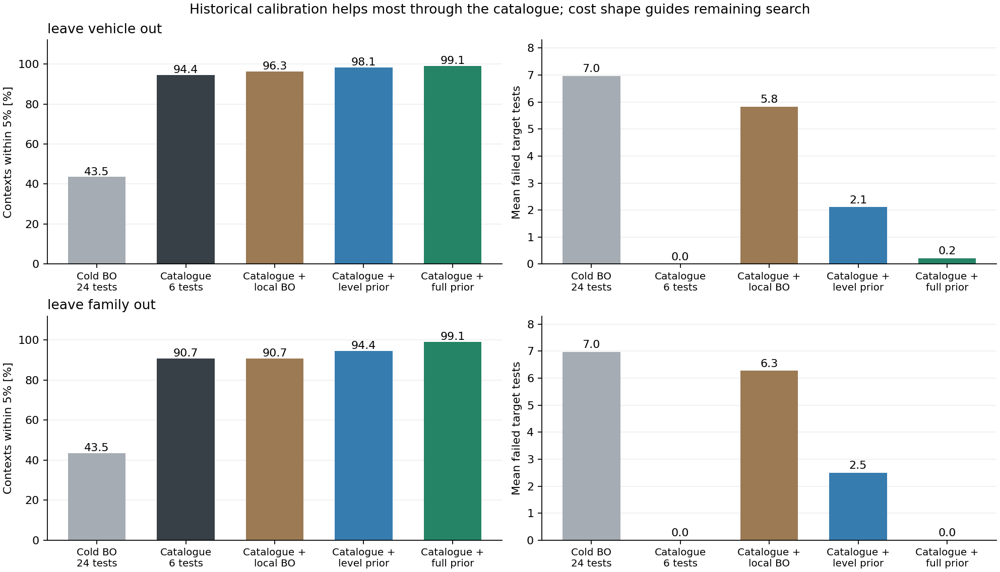

# FedBO: consolidated experimental evidence

23 November 2026. Latest results: `9cfa7f0ff0b3b468e4c99e9094f491073d1e711a`.

Historical calibration data help the current trajectory-tracking task through a
small context-dependent gain catalogue and through guidance of the remaining BO
search. The final ablation finds useful information in both the historical cost
level and its dependence on gains. The evidence for vehicle-specific tuning is
weaker than the evidence for trajectory-context dependence. A practical need for
a federated learning protocol remains unestablished.

This closes the current experiment chain. No further experiment is prepared here.

## Verification and scope

The latest campaign contains all 360 prescribed jobs, 12 source-exclusion folds,
28,080 requested cached observations, 4,320 budget outcomes and 25,920 context
outcomes. Every query, eligibility label and incumbent was checked against the
archive. Independent validation rescoring reproduces the saved trial, context,
summary and paired-effect tables. Frozen source copies, source exclusions,
constant-prior projection and common initial observations pass verification.
The no-additional-prior and full-cost controls exactly reproduce the preceding
campaign's corresponding traces. Initial six-query treatment effects are zero.

The final study changes only the historical log-cost mean: zero, a uniform mean
over all 71 gain candidates within each context, or the complete historical GP
mean. Historical feasibility rates are neutral in all three BO arms; target-side
cost and feasibility learning remain active. The shared catalogue already uses
historical cost and eligibility information.

Budgets are 6/12/24 total target rollouts per vehicle across six contexts. Failed
attempts consume budget. Twenty optimizer seeds reuse two target-calibration noise
realizations; validation uses two separate noise realizations. Source histories
contain 6,816 rollouts for leave-vehicle-out and 5,112 for leave-family-out. This
is a finite-pool replay, with no new nonlinear simulation or optimization during
this consolidation.

Reproduce the verification and derived tables from the repository root:

```bat
python code/scripts/consolidate_tracking_evidence.py
```

Input hashes and the analysis-script hash are saved in [verification.json](verification.json).
The original result archives and optimizer sources are unchanged.

## 1. What the final ablation establishes

Leave-family-out, at the 24-rollout allowance:

| Method | Actual tests | Contexts within 5% | All six contexts within 5% | Mean validation J | Mean failed tests |
|---|---:|---:|---:|---:|---:|
| Fixed catalogue | 6 | 90.74% | 66.67% | 0.708976 | 0.00 |
| Catalogue + local BO | 24 | 90.74% | 66.67% | 0.708014 | 6.28 |
| Catalogue + context-level prior | 24 | 94.44% | 83.33% | 0.705702 | 2.50 |
| Catalogue + full cost prior | 24 | 99.07% | 94.44% | 0.703925 | 0.00 |

All recommended six-context policies are eligible. Success percentages describe
the fixed nine-vehicle sample and repeated searches, not population probabilities.

Context-level centering improves final context success by 3.70 percentage points
and reduces failed tests by 3.78 relative to catalogue-initialized local BO. The
full gain-dependent prior adds another 4.63 percentage points and avoids the
remaining 2.50 failed tests. Its additional mean-J improvement over the level
prior is 0.252%, using the ratio of fleet means. Its improvement over the fixed
catalogue is 0.712%.

Thus, the full-prior advantage cannot be explained entirely by context-specific
centering. Gain dependence contributes under this fixed GP/acquisition procedure.
Centering itself is also useful at the final budget. It is not uniformly useful
at every budget: at 12 tests, the level arm has 1.56 failed tests versus 0.94 for
the local-BO arm, without improving context success.

Leave-vehicle-out gives the same qualitative final-budget ordering:

| Method | Contexts within 5% | All six contexts within 5% | Mean validation J | Mean failed tests |
|---|---:|---:|---:|---:|
| Fixed catalogue | 94.44% | 66.67% | 0.706862 | 0.00 |
| Catalogue + local BO | 96.30% | 77.78% | 0.704654 | 5.83 |
| Catalogue + context-level prior | 98.15% | 88.89% | 0.704250 | 2.11 |
| Catalogue + full cost prior | 99.07% | 94.44% | 0.703143 | 0.22 |

Here, full versus level adds 0.93 percentage points of context success, reduces
failed tests by 1.89, and improves the fleet mean J by 0.157%. All paired J
contrasts contain all 180 eligible pairs per protocol; no failure-conditioned
subset explains these cost differences.

### Individual cases constrain the aggregate conclusion

Full-prior BO is not uniformly better for every target or noise realization.
For compact/front-tire under leave-family-out, both level and full priors achieve
complete near-reference success, while level obtains lower mean J: 0.818385
versus 0.822270. Full uses fewer failed tests: zero versus one.

The remaining full-prior miss in both protocols is SUV/front-tire at 30 m/s and
0.3 Hz under calibration noise seed 101. The chosen candidate g010 has a
validation gap of 6.166%. Ten optimizer seeds repeat that miss in each protocol.
Under leave-vehicle-out, local BO finds the dense-reference candidate g062 and
passes for both calibration-noise realizations. The full prior therefore guides
search effectively on average while retaining a concrete negative-transfer case.

At a retrospectively examined 10% tolerance, the six-query catalogue already
passes every context and vehicle in both protocols. The 5% criterion remains the
declared primary result. The importance of BO refinement depends on the required
precision; these experiments do not establish an engineering need for 5%.

See [paired_effects.csv](paired_effects.csv), [vehicle_outcomes.csv](vehicle_outcomes.csv),
[remaining_misses.csv](remaining_misses.csv), and
[threshold_sensitivity.csv](threshold_sensitivity.csv).

## 2. Answers to the tracking study's three questions

### Q1: Is there tuning headroom, and is it mainly vehicle-specific?

The original hand-tuned gains are eligible on 41/54 controlled validation cells.
The best common free three-gain controller, vehicle-fixed choices and
vehicle/context choices are eligible on all 54 cells. Their fleet mean J values
are 1.063750, 1.034302 and 0.698408, respectively.

Allowing one fixed gain vector per vehicle improves J by only 2.77% over one
common gain vector. Allowing gains to change with vehicle and context improves J
by 34.34% over the common fixed vector. There is substantial tuning headroom,
especially in allowing reference-dependent gains. Baseline conditional cost on
41 successful cells must not be compared with fleet means on all 54 cells.

This study directly tunes the three feedback gains Ky, Kpsi and Kr. It reuses
the CFL-FF nonlinear plant, kinematic feedforward and fixed feedback structure,
without a learned feedforward network. It does not tune LQI Q/R matrices.

### Q2: Does the reference context matter?

Yes. The six controlled contexts vary speed and frequency at matched peak
lateral demand. Median pairwise overlap of the 5%-near-optimal gain sets across
contexts is zero. A compact frequency-indexed catalogue transfers well across
vehicles and speeds. In the source-only budgeted comparison, that catalogue
already gives J=0.706862 or 0.708976, close to the dense calibration-selected
vehicle/context finite-pool reference J=0.698408.

Context dependence supplies a clearer organizing principle than physical family
labels alone. It does not prove vehicle differences never matter. The original
diagnostic includes a held-out reference bank, but the final BO-refined policies
have not been re-evaluated on that bank. Their 99.07% result concerns the six
controlled contexts with held-out measurement noise, not unseen trajectory shapes.

### Q3: Can other vehicles provide useful tuning experience?

Yes, relative to the tested cold-start BO baseline under the same target cap.
At 24 tests, independent BO reaches 43.52% context success with mean J=0.888235
and 6.97 failed tests. A transferred catalogue reaches 90.74–94.44% success with
six target tests. Full-prior BO improves the remaining search, especially its
failed-test count. Excluding the target's entire family retains these benefits.

The evidence supports reusable historical information. It does not show a need
for client clustering, a vehicle-specific learned model, or continuous federated
training. The full prior's gain over the catalogue is modest in mean J and more
visible in near-reference success and avoidance of poor experiments.



The figure uses the original cold-BO benchmark and the freshly rerun final-study
arms. Control audits connect the archived campaigns exactly. Catalogue spends
six tests; all BO arms spend 24. These are developmental failure counts, not
certified safety probabilities.

## 3. Which historical information matters?

| Information or mechanism | Evidence | Conclusion within this task |
|---|---|---|
| Small context-dependent catalogue | Six target tests already give 90.74–94.44% success | Largest practical contribution to mean performance |
| Historical context-specific cost level | Improves final success and failed-test count over zero extra mean | Useful partial explanation |
| Gain-dependent historical cost structure | Full prior improves over the mean-preserving level arm | Additional useful search information |
| Separate historical feasibility-rate prior | Previous cost-only and combined-prior arms have identical final success flags and failed-test counts | Little additional value once the cost prior is active |
| Explicit family-based personalization | Strong performance remains when the whole target family is excluded | Its necessity is unestablished |

The feasibility-only arm previously cut failed tests from 6.28 to 1.00 under
leave-family-out, without improving context success beyond 90.74%. Cost-only
reached 99.07% with zero failed tests. Adding the feasibility prior to cost-only
changed fleet mean J by about 0.0104% in that protocol, with identical final
success and failure outcomes. Target feasibility learning remains active, and
source cost fitting/catalogue construction already use historical eligibility;
historical feasibility information is therefore not absent from the cost-only
pipeline.

The working explanation is that good historical initialization supplies a useful
region of gains, while cost level and gain dependence guide the remaining search.
The gain-dependent prior helps avoid high-cost regions even when their rollouts
meet the eligibility bounds. This is an algorithmic attribution under the frozen
optimizer, not proof of a general causal law for controller-tuning landscapes.

## 4. How the earlier yaw-rate work changes the interpretation

In the corrected LQI studies, transferred design weights were followed by
target-specific identification and gain synthesis. Common weights could therefore
produce different feedback laws on different vehicles. The corrected direct
transfer study met its 5% criterion in all 450 donor/target cases at source
budget 25 for each tested source method. Earlier actuator failures affected by
the anti-windup sign error must not be used to motivate a transfer barrier.
The detailed scope and provenance are in
[corrected_transfer_consolidation.md](../corrected_transfer_consolidation.md).

The cooperative pilot did not establish an allocation advantage: its successful
donor-transfer trials used 54 search queries, coordinated search used 93 and the
selective heuristic used 123. Transfer also had unresolved/invalid trials, and
only one optimizer seed was run; successful cases alone cannot establish a
general ranking. The limited-excitation gate likewise retained a shared
acceptable candidate in all nine primary requests, so it did not establish a
need to distinguish the nonlinear plant hypotheses for the tuning decision.

The trajectory task adds clearer context dependence and a cost penalizing
steering activity alongside true tracking error. It provides stronger evidence
for useful historical guidance. Across both task formulations, inexpensive
reuse remains a strong comparator that a more elaborate method must justify.

## 5. Supported claims, limits, and scientific decision

**Supported:** In the tested finite-pool trajectory-calibration task, a small
source-derived catalogue sharply improves on cold-start BO. Additional
gain-dependent historical cost information improves search beyond
context-specific centering under a restricted target budget, primarily through
near-reference coverage and fewer failed experiments. These improvements persist
under whole-family exclusion, with individual negative-transfer cases.

**Unestablished:** a practical requirement for federation; superiority to a
well-chosen compact calibration library; benefits after charging for source-data
collection; privacy or communication advantages; a need for clustered or
personalized federation; stability guarantees; continuous-domain optimality; and
generalization of the final BO policies to new trajectory shapes or real fleets.

Nine deterministic vehicle configurations, two target-noise realizations and
two validation repeats provide limited population coverage. At the final budget,
success flags and failure counts are identical across the ten optimizer seeds
sharing a vehicle/noise realization; these repetitions do not add independent
physical evidence. Finite-pool boundary optima remain unresolved. Scoring and
eligibility checks use simulator truth. Cost scales, eligibility constraints and
the 5% tolerance are research choices. The large
source archive is treated as already available and its acquisition cost is not
charged to the target. No networked federated protocol is evaluated.

**Decision:** freeze this experiment chain and retain the catalogue-plus-cost-prior
method as a validated simulation baseline. Its value is established more clearly
than a need for a new federated algorithm. Use this consolidated evidence to
choose the research direction before expanding the experimental scope.
