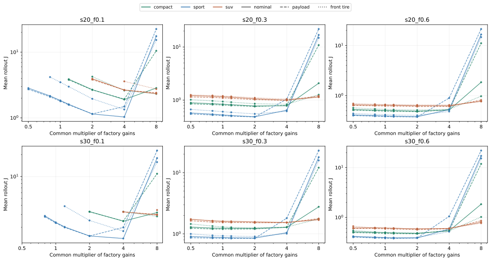

# Heterogeneous cost-model review

24 November 2026. This follows the [frozen consolidation](fedbo_consolidation.md)
and the [matched peer-assisted analysis](analysis/peer_assisted_cost_model/report.md).
It uses completed archives and code inspection. No controller rollout, BO
proposal, new online model or experimental campaign is run by this review.

Follow-up: the reference was subsequently implemented and tested. The
[joint shared/local analysis](analysis/joint_shared_local_cost_model/report.md)
finds a heterogeneous final-budget improvement over A, a homogeneous loss to A,
and a heterogeneous context-success tradeoff against B. The structural review
below retains its original scope; those results do not isolate a causal repair
to the previous C model.

## 1. Consolidated conclusion and scope of this review

With the same peer-first rule, the additional federated mean improves on the
same mean fitted locally for homogeneous vehicles in all three seeds. It harms
the declared final-budget heterogeneous context-success comparison in all three
seeds. The simpler peer-sharing/local-GP reference remains stronger on some
metrics and seeds. This is the result to retain, without changing the budget,
threshold or method definition to produce a different ranking.

The modeling question is which cost structure can be shared, what vehicle-local
structure remains, and what uncertainty should accompany transfer. The existing
data do not uniquely identify the causal mechanism behind the heterogeneous
full-policy failure. A structural issue in a model is not, by itself, proof
that correcting it improves finite-budget BO.

## 2. The current model already has a local correction

For x consisting of normalized gain coordinates, speed and log frequency, C uses

\[
 y_i(x)=\log J_i(x),\qquad
 \widehat y_i(x)=m_{\widehat w}(x)+\widehat r_i(x).
\]

The shared mean is a 65-coefficient fixed-feature regressor; r_i is a target-only
residual GP. Vehicle identity and physical descriptors are absent from x. All
vehicles receive the same shared mean at the same gain/context, but their full
predictions differ through their local GP observations and fitted kernel.
It would be incorrect to describe C as having no personalization or to propose
adding a local residual as though it were missing.

The physical conditions are nine compact/nominal clones versus the existing
compact/sport/SUV families with nominal, payload and front-tire variants. The
heterogeneous plants differ in mass, yaw inertia, axle geometry and tire
parameters. The feedback structure, cost scales and candidate gain pool are
common. Controller kinematic feedforward uses wheelbase; the cost surrogate
does not use it or the other plant parameters as inputs.

| Nominal anchor | Mass [kg] | Yaw inertia [kg m²] | l_f / l_r [m] | Front / rear Pacejka B |
|---|---:|---:|---|---|
| Compact | 1220 | 1500 | 1.05 / 1.45 | 9 / 10 |
| Sport | 1520 | 1800 | 1.15 / 1.35 | 13.5 / 14 |
| SUV | 2550 | 5200 | 1.30 / 1.55 | 7.5 / 8 |

Each anchor has a nominal version, a 20% payload version with the declared
rearward CG/inertia change, and a version with front-tire B multiplied by .85.
Other Pacejka shape parameters also differ between anchors. This is a
deterministic 3x3 fleet with no manufacturing scatter. It does not isolate the
effect of one physical coefficient or provide independent physical fleet draws.
The low-dimensional diagnostic below can partly reflect this construction.

## 3. What the shared training objective actually estimates

With only eligible records, the current pooled regression objective is

\[
 L_t(w)=\frac1{N_t}\sum_i\sum_{k\in D_{i,t}^{\rm eligible}}
  [\phi(x_{ik})^\top w-y_{ik}]^2+\lambda\|w\|^2.
\]

FedAvg closely approximates this objective. It fits one mean to the labels of
the vehicles that happened to observe each input and satisfy eligibility.
There is no vehicle-specific term in this regression loss. Local residuals are
fitted afterwards and do not participate in deciding which variation the
shared regression should explain.

For heterogeneous vehicles, the population quantity approximated by an
unconditioned predictor is a mixture over vehicle identity at each input.
The mixture depends on which vehicles queried that gain/context, whether they
were eligible, and the current online policy. These weights can change although
the underlying plants are stationary. This is a statistical interpretation of
the objective, not an empirical claim that all of the failure is caused by
mixture drift.

Before the final query, family sample weights in the heterogeneous C arm are
roughly 30--36% per family. There is no evidence that one family overwhelmingly
dominates the model merely through sample count. The more basic issue is that
the predictor does not condition on which vehicle generated a cost label.

## 4. Existing data reveal gain-dependent vehicle differences

The new review script first revalidates the completed matched campaign. It then
uses the dense **calibration** bank with its two frozen repeats, strictly as an
evaluator-only diagnostic. It does not use this bank to initialize a learner,
learn deployment descriptors or choose an online controller.

For each context, retain gains eligible for every one of the nine heterogeneous
plants in both calibration repeats. Let Y_ij be vehicle i's mean log cost for
common candidate j. Decompose

\[
 Y_{ij}=\overline Y_{\cdot j}+b_i+R_{ij},\qquad
 b_i=\operatorname{mean}_j(Y_{ij}-\overline Y_{\cdot j}).
\]

The first term is a completely flexible shared lookup over gains. The local
offset b_i can remove vehicle/context cost-level differences. R_ij is the
remaining gain-dependent interaction. This decomposition is more flexible
than our finite-feature model and provides a descriptive diagnostic, not an
online replacement.

| Context | Gains eligible for all nine / 71 | Gains eligible for at least one / 71 | Between-vehicle log-cost RMS | Fraction of between-vehicle variation removed by a vehicle/context offset |
|---|---:|---:|---:|---:|
| 20 m/s, .1 Hz | 19 | 65 | .514 | 23.5% |
| 20 m/s, .3 Hz | 62 | 68 | .584 | 2.0% |
| 20 m/s, .6 Hz | 64 | 70 | .600 | 2.8% |
| 30 m/s, .1 Hz | 7 | 50 | .505 | 9.8% |
| 30 m/s, .3 Hz | 54 | 62 | .524 | 1.6% |
| 30 m/s, .6 Hz | 59 | 64 | .614 | 4.7% |

Two-repeat log-cost noise SD estimates on these cells are .009--.035. The
between-vehicle differences are substantially larger. The repeat estimates
are descriptive, based on only two paired noise realizations; they are not
independent high-confidence noise calibrations.

Offsets explain little of the variation over most common feasible gain pools.
Therefore "use the same cost shape but a different scalar level" is not a
sufficient explanation of the observed full-pool heterogeneity. This does not
prove an offset adjustment cannot help BO; it limits that explanation.

The historical context-level ablation addresses another axis: the average cost
across gains changes with trajectory context. Its positive result does not
imply that vehicle differences at a fixed context are also only offsets.

### Relevance near useful controllers

Within each common eligible pool, form the union of gains within 5% of each
vehicle's own calibration-selected common-pool minimum. At .3/.6 Hz these unions
contain 11--20 gains; local offsets remove only 3.4--16.3% of their between-
vehicle variation. Gain-dependent differences therefore remain near useful
settings in those contexts.

At 20 m/s, .1 Hz the union has only two gains and offsets remove 99.3% of its
variation. At 30 m/s, .1 Hz it has one gain, so local shape is not identifiable
on that subset. The broader shape conclusion must not be applied uniformly to
these tiny low-frequency regions. These are common-pool calibration diagnostics,
not the primary held-out-validation success metric.

Different cost curves can still share useful minimizers or overlapping
near-optimal sets. Shape differences therefore do not contradict successful
gain transfer or prove a need for a different controller on every vehicle.

### Gain dependence is structured, without proving a need for clusters

Two singular components explain 94.4--98.9% of the centered shape interaction
within each context. With contexts equally weighted, two components explain
95.54% jointly. This suggests low-dimensional task variation in this particular
constructed fleet; it does not establish that two latent coefficients can be
identified online from 24 trials or generalize to new vehicles.

A separate full gain-dependent lookup for each known family removes about
76--83% of the full-pool between-vehicle variation. This uses the complete
calibration bank and oracle family assignments. It is a retrospective
descriptive bound, not evidence that online clustering is necessary or will
improve the BO decisions. A learned basis, task descriptors and local random
effects are distinct ways of representing such structure.



The figure shows only the seven common-scaling anchors, theta=alpha*theta_factory,
not the entire three-dimensional gain domain. Each curve uses mean calibration
J; a point is shown only if both repeats are eligible. Gaps denote ineligible
anchors. Logarithmic axes reveal how cost dependence on the same gain scaling
differs across plants; this figure is not a new trajectory experiment.

## 5. The online mean has limited distinct input support

Before local query 24, C has the following eligible records available:

| Condition | Eligible records across fleet | Distinct eligible gain/context inputs | Unregularized feature rank | Ridge effective degrees of freedom |
|---|---:|---:|---:|---:|
| Homogeneous, seeds 1100--1102 | 188--191 | 34--37 | 34--37 of 65 | 11.0--11.8 |
| Heterogeneous, seeds 1100--1102 | 164--180 | 37--44 | 37--44 of 65 | 10.8--12.4 |

Repeated verification gives multiple labels at the same gain/context, not
equally many distinct feature inputs. Ridge regularization makes fitting
well-posed. Rank deficiency is normal in regularized feature models and is not
proof that 65 coefficients are intrinsically excessive. The effective degrees
of freedom are computed as sum gamma_j/(gamma_j+lambda) for eigenvalues of the
sample-averaged feature Gram matrix.

However, many coefficient directions are determined mainly by regularization.
A point estimate and convergence to its ridge optimum do not establish that
its extrapolations are known accurately.

On the actual C inputs, RMS disagreement of repeated log-cost labels around
their input-specific mean is .012--.020 for homogeneous fleets and .278--.558
for heterogeneous fleets. Since a local gain/context pair is never repeated,
these duplicate-input labels come from different clients. Any unconditioned
function of gain/context alone must compromise between these labels. The local
GP can correct them at the target, but it has only that target's limited tests.

## 6. Shared-mean uncertainty is absent from the current predictive variance

For fixed GP kernel hyperparameters, the implemented target variance is

\[
 s_i^2(x)=k(x,x)-k(x,X_i)[K_i+\sigma_n^2I]^{-1}k(X_i,x).
\]

It contains no uncertainty term for the estimated shared coefficients or
vehicle-specific transfer discrepancy. Changing a deterministic mean does not
change this conditional variance. This is exactly the fixed-mean construction
in Rasmussen and Williams, Chapter 2, Section 2.7 [1].

The actual pipeline can change its variance **indirectly**: it refits local GP
kernel hyperparameters using residuals from the changing mean. Thus the claim
is not that A/B/C always have equal variances. The missing quantity is explicit
uncertainty about the fitted mean and the transfer to this vehicle.

The mean can include the target's own records, and those records also fit its
residual GP. This is an empirical-Bayes working procedure. It is not equivalent
to inserting donor predictions as additional target measurements, but its
conditional variance is not a full joint posterior for all learned components.
No proof here establishes that the resulting uncertainty error caused the
heterogeneous failure or that its direction is uniformly overconfidence.

An independent Gaussian prior over mean coefficients contributes an additional
covariance when marginalized [1]. In this pipeline the components share data,
so simply adding an independent variance term after both fits would generally
omit dependence. A coherent joint model should condition each observation once
and retain shared/local posterior covariance.

## 7. Eligibility and adaptive catalogue feedback remain separate mechanisms

The mean uses eligible costs only. All successful and failed local attempts
train the target's local eligibility surrogate. A gain feasible only for sport
clients can therefore supply cost labels to the shared model without supplying
an eligible SUV cost at that input. The model should not silently interpret the
absence of that SUV label as transferable evidence of low target cost.

The .1 Hz eligibility regions vary greatly: at 30 m/s an individual vehicle has
7--46 eligible candidates, with only seven common to all. Common-pool cost
decompositions exclude precisely the inputs with heterogeneous eligibility and
therefore cannot explain all online failure behavior.

Different fallback discoveries change which peer gains are published, verified
and become later data. The fixed-kernel common-history diagnostic from the
previous analysis does not reproduce that closed feedback loop or adaptive GP
hyperparameters. Its lower one-step costs do not contradict poorer full-policy
results. These channels have not been causally isolated.

## 8. Recommended modeling reference, before another experimental variant

The recommended reference is a **joint shared/local cost model with shrinkage
of gain-dependent vehicle effects and explicit predictive uncertainty**. An
analytically clear feature-space example is

\[
 y_{ik}=\phi(x_{ik})^\top(w_g+u_i)+\epsilon_{ik},\qquad
 w_g\sim\mathcal N(0,\Sigma_g),\quad
 u_i\sim\mathcal N(0,\Sigma_\ell).
\]

This is a modeling reference, not a newly implemented method. It can also be
written as a shared-plus-local covariance over input and client identity:

\[
 k((x,i),(x',j))=
 \phi(x)^\top\Sigma_g\phi(x')+
 \mathbf1_{i=j}\phi(x)^\top\Sigma_\ell\phi(x').
\]

Each vehicle can have gain-dependent differences, shrunk toward a shared
structure when its data are scarce. Shared and local components are inferred
together; neither a new independent GP correction nor a scalar offset alone
is the central change. The prediction uncertainty is based on the posterior
of w_g+u_i, including their dependence. With Gaussian noise and fixed covariance
settings this is a tractable linear-Gaussian reference model; estimating its
hyperparameters and deploying a federated approximation remain design work.

Ordinary federated optimization can still be used for a corresponding MAP
objective. Averages of model vectors alone do not provide the joint posterior
uncertainty. The statistical model and the method used to communicate/optimize
it must be kept conceptually separate.

The low-dimensional shape diagnostic motivates considering a constrained or
low-rank local covariance, but the dense archive must not supply the deployed
basis or local coefficients for free. Proper shrinkage and identification from
the same online observations remain necessary. Client identity is already
available; no oracle vehicle parameters are required by this reference.

If defensible task descriptors z_i are available, a conditional mean
m_w(theta,c,z_i) is another principled representation [2,3]. Exact mass, tire
parameters or dense-archive cost profiles must not be assumed known merely
because the simulator contains them. Wheelbase alone does not distinguish
compact and sport anchors here, which both have L=2.5 m, or the within-family
payload/tire variants. Response descriptors must use completed earlier data and
retain their calibration context; features containing the current query's
realized cost components would leak its label.

## 9. Review decision

1. Retain the frozen condition-dependent experimental claim and the strong A
   comparator. Controller-gain transfer and cost-surrogate pooling require
   different assumptions.
2. Give the next cost-model definition an explicit task-dependent,
   gain-dependent component. A context offset alone is not a general explanation
   of the measured differences. C already has local residual learning, so the
   key decisions concern joint fitting, shrinkage and uncertainty, not merely
   adding another local model.
3. Specify which quantities are globally shared, locally estimated and known
   before any test. Use each observation consistently in the probabilistic
   model. Keep eligibility learning and peer priority unchanged in any later
   isolated cost-model comparison.
4. Do not choose a new FL solver, hard family clusters, extra local tests or a
   new primary metric as a substitute for that modeling decision. This review
   does not establish that the reference model will beat A, nor that it can be
   calibrated within the current budget.

The next artifact should be a precise statistical model and its information
contract, before another full simulation campaign. This review supplies that
direction and an analytical reference; it prepares no experimental variant.

## Reproduction and primary references

```bat
python code/scripts/review_tracking_heterogeneous_model.py
```

Derived tables, the vector figure and input fingerprints are in
[analysis/heterogeneous_cost_model_review](analysis/heterogeneous_cost_model_review).
The script revalidates the completed campaign, then computes only archive
decompositions and actual-history feature diagnostics. It performs no new
physical rollouts, BO proposals or online model fits. The input domain remains
five-dimensional and all original result/source fingerprints remain frozen.

1. C. E. Rasmussen and C. K. I. Williams, *Gaussian Processes for Machine
   Learning*, Chapter 2, Section 2.7, 2006.
   [Primary chapter](https://gaussianprocess.org/gpml/chapters/RW2.pdf).
   Used for the distinction between a fixed mean and uncertainty in explicit
   mean coefficients.
2. E. V. Bonilla, K. M. A. Chai and C. K. I. Williams, *Multi-task Gaussian
   Process Prediction*, NIPS 2007.
   [Primary paper](https://proceedings.neurips.cc/paper_files/paper/2007/file/66368270ffd51418ec58bd793f2d9b1b-Paper.pdf).
   Used for modeling task correlations separately from input similarity; its
   results do not guarantee useful transfer in the present BO protocol.
3. E. V. Bonilla, F. V. Agakov and C. K. I. Williams, *Kernel Multi-task Learning
   using Task-specific Features*, AISTATS 2007.
   [Primary paper](https://proceedings.mlr.press/v2/bonilla07a/bonilla07a.pdf).
   Used for descriptor-conditioned prediction as an alternative to task-identity
   modeling, subject to actual descriptor availability.
